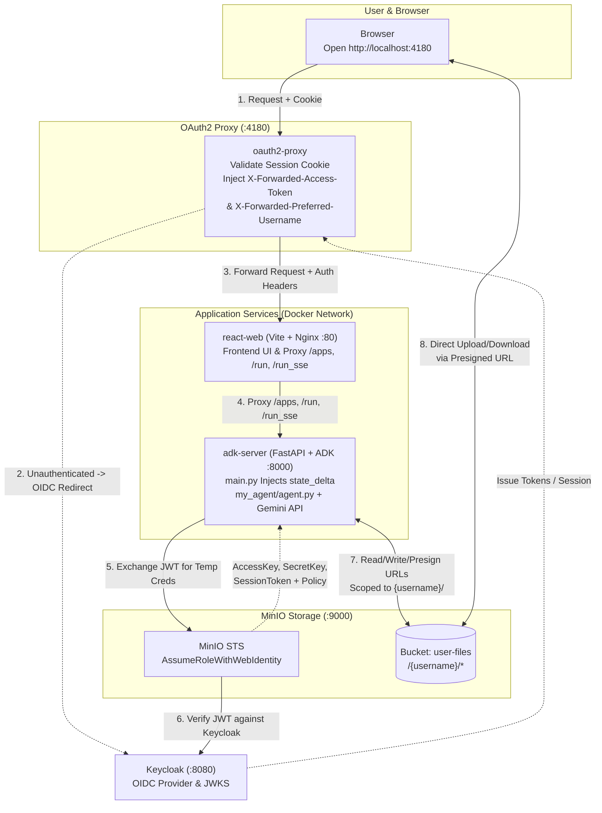

# ADK File Assistant with OAuth2 Proxy, Keycloak & MinIO STS

A personal file-management assistant built with **Google ADK (FastAPI)** and **MinIO**, using **OAuth2 Proxy** in front of a **Vite React** web app to handle **Keycloak (OIDC)** authentication and **MinIO STS (`AssumeRoleWithWebIdentity`)** to scope each user strictly to their own `{username}/` directory.

---

## Architecture & Request Flow



### AuthN & AuthZ Boundaries

1. **OAuth2 Proxy + Keycloak:** Handles browser login and session cookies, forwarding `X-Forwarded-Access-Token` and `X-Forwarded-Preferred-Username` downstream so React does not need client-side auth code.
2. **ADK Server Middleware (`adk-server/main.py`):** Reads proxy headers, enforces `user_id`, and injects `keycloak_token` and `username` into `state_delta` on `/run` and `/run_sse`.
3. **MinIO STS + IAM Policy (`user-folder-policy.json`):** Exchanges the user's JWT for short-lived STS credentials and restricts bucket access to `user-files/${jwt:preferred_username}/*`.

---

## Project Structure

```text
.
├── .env
├── docker-compose.yaml
├── oauth2-proxy.cfg
├── user-folder-policy.json
├── README.md
├── adk-server/
│   ├── Dockerfile
│   ├── .dockerignore
│   ├── requirements.txt
│   ├── main.py
│   └── my_agent/
│       ├── __init__.py
│       └── agent.py
└── react-web/
    ├── Dockerfile
    ├── nginx.conf
    ├── package.json
    ├── vite.config.ts
    └── src/
```

---

## Setup & Running

### 1. Configure Keycloak

1. Create a realm named `my-realm`.
2. Create a client named `adk-minio-client` and add `http://localhost:4180/oauth2/callback` to **Valid Redirect URIs**.
3. Ensure the access token includes `preferred_username` and an `aud` claim matching your expected audience configuration.

### 2. Create `.env` and `oauth2-proxy.cfg`

* Add `GOOGLE_GENAI_API_KEY=...` to `.env` in the project root.
* Set `client_secret` and a 32-byte URL-safe base64 `cookie_secret` in `oauth2-proxy.cfg`. Do **not** commit `.env` or secrets to Git.

### 3. Build and Start with Docker Compose

```bash
docker compose up --build -d
```

### 4. Verify

* **App via Proxy:** Open `http://localhost:4180` and sign in through Keycloak.
* **MinIO Console:** Open `http://localhost:9001` (`minioadmin` / `minioadmin_password`) to inspect the `user-files` bucket and `user-folder-policy`.
* **Service Logs:**

  ```bash
  docker compose logs -f oauth2-proxy adk-server minio
  ```

---

## Security & Network Notes

* **Do not expose `adk-server` port `8000` publicly:** Keep it internal to the Docker network so callers cannot spoof `X-Forwarded-*` headers.
* **Presigned URLs:** Have the browser upload/download large files directly against MinIO using presigned URLs, and configure bucket CORS for your app origin.
* **Production hardening:** Set `cookie_secure = true` behind HTTPS and enable `REQUIRE_JWT_SIGNATURE=true` in `adk-server`.

---

## Troubleshooting

### Keycloak Errors

* **`invalid_redirect_uri` or login redirect loop:**
  * Confirm `http://localhost:4180/oauth2/callback` is listed under **Valid Redirect URIs** for `adk-minio-client` in `my-realm`.
  * Check that `oidc_issuer_url` / issuer URLs match the realm's configured issuer (`iss` claim in the token).
* **Missing `preferred_username` claim in JWT:**
  * In Keycloak, verify the `profile` client scope is assigned to `adk-minio-client` or add a **User Property** protocol mapper mapping `username` to `preferred_username`. If absent, the code falls back to `sub`.
* **JWT `aud` (Audience) validation failure (`REQUIRE_JWT_SIGNATURE=true`):**
  * Inspect decoded token claims and add an **Audience** mapper for `adk-minio-client` (or `account`) in Keycloak, or align `KEYCLOAK_AUDIENCE` with the token's `aud` value.

### OAuth2 Proxy Errors

* **`401` / missing `X-Forwarded-Access-Token` in `adk-server`:**
  * Verify `pass_access_token = true` and `pass_user_headers = true` are set in `oauth2-proxy.cfg`.
  * Confirm the client is actually receiving a JWT access token from Keycloak rather than an opaque token, and that requests go through `http://localhost:4180` rather than bypassing the proxy.
* **`cookie_secret` startup error:**
  * OAuth2 Proxy requires a 16-, 24-, or 32-byte key encoded with URL-safe base64. Generate one with:

    ```bash
    python3 -c 'import os,base64; print(base64.urlsafe_b64encode(os.urandom(32)).decode())'
    ```

* **SSE streaming (`/run_sse`) buffers or times out:**
  * Ensure Nginx (`react-web/nginx.conf`) disables proxy buffering (`proxy_buffering off;`) and sets sufficiently long read timeouts for streaming responses.

### MinIO STS Errors

* **`AccessDenied` when calling `AssumeRoleWithWebIdentity`:**
  * Verify `MINIO_IDENTITY_OPENID_CONFIG_URL` is reachable from the `minio` container (`http://keycloak:8080/realms/my-realm/.well-known/openid-configuration`) and `MINIO_IDENTITY_OPENID_CLIENT_ID` matches `adk-minio-client`.
  * Check that the JWT is not expired and `RoleArn` matches the MinIO STS role format expected by your setup.
* **`AccessDenied` on `ListBucket`, `GetObject`, or `PutObject` inside `{username}/`:**
  * Check `user-folder-policy.json` to ensure `${jwt:preferred_username}` matches the token's `preferred_username` value and the prefix `s3:prefix` allows `${jwt:preferred_username}/*`.
  * Confirm `minio-init` completed cleanly and created both the `user-files` bucket and `user-folder-policy`.
* **Browser fails to load or upload via Presigned URL:**
  * If the browser runs on the host machine while `adk-server` runs inside Docker, generating presigned URLs with an internal Docker hostname like `minio:9000` can fail in the browser if `minio` does not resolve on the host—use a browser-reachable endpoint/host and configure CORS on the `user-files` bucket (`mc cors set`).
