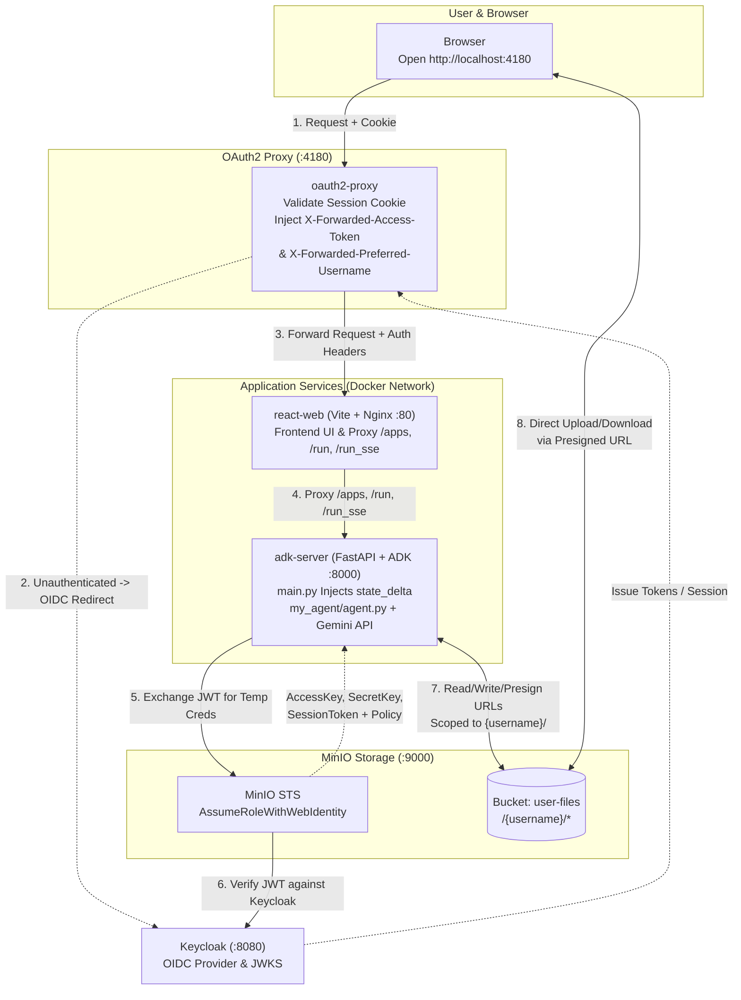

# ADK File Assistant with OAuth2 Proxy, Keycloak & MinIO STS

A personal file-management assistant built with **Google ADK (FastAPI)** and **MinIO**, using **OAuth2 Proxy** in front of a **Vite React** web app to handle **Keycloak (OIDC)** authentication and **MinIO STS (`AssumeRoleWithWebIdentity`)** to scope each user strictly to their own `{username}/` directory.

Chat with a Gemini-powered agent that lists, reads, creates, and shares your files — while the storage layer *provably* cannot see anyone else's.

---

## Architecture & Request Flow



### AuthN & AuthZ Boundaries

1. **OAuth2 Proxy + Keycloak:** Handles browser login and session cookies, forwarding `X-Forwarded-Access-Token` and `X-Forwarded-Preferred-Username` downstream so React does not need client-side auth code.
2. **ADK Server Middleware (`adk-server/main.py`):** A raw-ASGI `AuthInjectMiddleware` that validates the proxy headers, **re-pins the authenticated identity** onto every request (both the `/apps/.../users/{user}/...` path and the `user_id` field of `/run` / `/run_sse` bodies), and injects `keycloak_token` + `username` into `state_delta` so the agent's tools receive them. A caller can never act as another user.
3. **MinIO STS + IAM Policy (`user-folder-policy.json`):** Exchanges the user's JWT for short-lived STS credentials (15 min) and restricts bucket access to `user-files/${jwt:preferred_username}/*` — enforced by MinIO itself, independent of application code.
4. **Path sandbox (`_safe_user_path` in `agent.py`):** Even with STS scoping, every tool path is normalized and pinned under `{username}/`, rejecting `../` traversal.

---

## Features

| Tool | What it does |
|---|---|
| `list_my_files` | Lists objects under the caller's `{username}/` prefix |
| `upload_text_file` | Creates/overwrites a UTF-8 text file in the user's folder |
| `read_text_file` | Reads a text file from the user's folder |
| `delete_file` | Deletes a file from the user's folder |
| `get_download_link` | 10-minute presigned GET URL |
| `get_upload_link` | 10-minute presigned PUT URL (browser uploads direct to MinIO) |

* **Streaming replies** over SSE (`/run_sse`) with correct delta/final event handling in the React client.
* **Per-user isolation** verified end-to-end: user A cannot read or write user B's prefix (MinIO returns `AccessDenied`).
* **No client-side secrets:** React never sees a token; the proxy injects identity headers server-side.

---

## Project Structure

```text
.
├── .env                        # GOOGLE_GENAI_API_KEY
├── docker-compose.yaml         # All services (keycloak, minio, adk, react, proxy)
├── oauth2-proxy.cfg            # OIDC client + cookie config
├── user-folder-policy.json     # MinIO IAM policy (${jwt:preferred_username} scoping)
├── README.md
├── article.md                  # The story behind this build
├── keycloak/
│   └── my-realm.json           # Realm auto-imported on first boot
├── adk-server/
│   ├── Dockerfile
│   ├── .dockerignore
│   ├── requirements.txt
│   ├── main.py                 # AuthInjectMiddleware, CORS, API-key bridge
│   └── my_agent/
│       ├── __init__.py
│       └── agent.py            # Root agent + 5 MinIO tools
└── react-web/
    ├── Dockerfile              # Two-stage: node build → nginx serve
    ├── nginx.conf              # Reverse proxy /apps, /run, /run_sse (SSE-safe)
    ├── package.json
    ├── vite.config.ts
    └── src/
        ├── adkStream.ts        # SSE client, session ensure, partial/final handling
        ├── chatBox.tsx         # Chat UI
        └── App.tsx
```

---

## Setup & Running

### Prerequisites

* Docker + Docker Compose
* A **Google Gemini API key** (`AIza...`)

### 1. Configure Keycloak

The realm is **imported automatically** on first boot from `keycloak/my-realm.json` (`start-dev --import-realm`), pre-created with:

* Realm: `my-realm`
* Client: `adk-minio-client` (secret is set in `oauth2-proxy.cfg`), redirect URI `http://localhost:4180/oauth2/callback`
* Test user: **`alice` / `password123`** (use this to sign in)

If you create your own realm/client instead, make sure:

1. `http://localhost:4180/oauth2/callback` is in **Valid Redirect URIs**.
2. The access token includes the `preferred_username` claim (assign the `profile` client scope, or add a **User Property** protocol mapper).
3. The token's `aud` claim matches what `KEYCLOAK_AUDIENCE` expects (defaults to `adk-minio-client`; the compose file sets `account`).

### 2. Configure `.env` and `oauth2-proxy.cfg`

* Put your Gemini key in `.env`:

  ```bash
  GOOGLE_GENAI_API_KEY=AIza...
  ```

* Set `client_secret` (from Keycloak) and a 32-byte URL-safe base64 `cookie_secret` in `oauth2-proxy.cfg`. `cookie_refresh = "2m"` is enabled to automatically refresh OIDC access tokens. Generate the cookie secret with:

  ```bash
  python3 -c 'import os,base64; print(base64.urlsafe_b64encode(os.urandom(32)).decode())'
  ```

* Do **not** commit `.env` or secrets to Git.

### 3. Build and Start with Docker Compose

```bash
docker compose up --build -d
```

Startup order is health-gated: Keycloak → MinIO → `minio-init` (creates the `user-files` bucket and `user-folder-policy`) → `adk-server` / `react-web` / `oauth2-proxy`.

### 4. Verify

* **App via Proxy:** Open `http://localhost:4180`, sign in as `alice` / `password123`, and try:
  * *“สร้างไฟล์ชื่อ hello.txt เนื้อหา สวัสดี”*
  * *“รายชื่อไฟล์ของฉันทั้งหมด”*
  * *“อ่านเนื้อหาไฟล์ hello.txt”*
* **MinIO Console:** Open `http://localhost:9001` (`minioadmin` / `minioadmin_password`) to inspect `user-files/alice/...` and the policy.
* **Confirm the STS role ARN** (needed if you change MinIO config):

  ```bash
  docker compose logs minio | grep "IAM Roles"
  # INFO: IAM Roles: arn:minio:iam:::role/...
  ```

* **Service Logs:**

  ```bash
  docker compose logs -f oauth2-proxy adk-server minio
  ```

---

## Configuration Reference

### `adk-server` (compose `environment` + `.env`)

| Variable | Default / Example | Purpose |
|---|---|---|
| `GOOGLE_GENAI_API_KEY` | from `.env` | Gemini key. This ADK build only reads `GOOGLE_API_KEY`/`GEMINI_API_KEY`, so `main.py` bridges it automatically when neither is set. |
| `MINIO_ENDPOINT` | `minio:9000` | S3/STS endpoint (internal DNS). |
| `MINIO_USE_SSL` | `false` | TLS to MinIO. |
| `MINIO_BUCKET` | `user-files` | Bucket name. |
| `MINIO_ROLE_ARN` | `arn:minio:iam:::role/<generated>` | **Must** be the role MinIO generates — see Troubleshooting. |
| `REQUIRE_JWT_SIGNATURE` | `false` | When `true`, validates JWT signature/aud/issuer via JWKS. |
| `KEYCLOAK_JWKS_URL` | `.../protocol/openid-connect/certs` | JWKS endpoint for signature validation. |
| `KEYCLOAK_AUDIENCE` | `account` (compose) | Expected `aud` claim. |
| `KEYCLOAK_ISSUER` | `http://localhost:8080/realms/my-realm` | Expected `iss` claim. |
| `ALLOWED_ORIGINS` | `http://localhost:4180,...:5173` | Origins ADK's origin gate and CORS accept (comma-separated). |

### `minio`

| Variable | Purpose |
|---|---|
| `MINIO_IDENTITY_OPENID_CONFIG_URL` | Keycloak OIDC discovery document (used to mint STS tokens). |
| `MINIO_IDENTITY_OPENID_CLIENT_ID` | `adk-minio-client` |
| `MINIO_IDENTITY_OPENID_ROLE_POLICY` | `user-folder-policy` — the policy attached to STS sessions; also causes MinIO to generate the STS role logged as `IAM Roles:`. |

---

## How Identity Is Injected

`AuthInjectMiddleware` in `adk-server/main.py` is deliberately **raw ASGI**, not `BaseHTTPMiddleware`:

* It rewrites the `user` segment of `/apps/{app}/users/{user}/...` and the `user_id` of `/run` / `/run_sse` bodies to the authenticated username (the React client sends the placeholder `proxy-user`).
* It injects `state_delta.keycloak_token` and `state_delta.username`, which the agent's tools read from `tool_context.state`.
* Body rewriting uses a replay `receive` that defers to the real channel after the first message — an eager `http.disconnect` would cancel the `/run_sse` stream before the model replies.
* Auth failures **return** `JSONResponse(401)` instead of raising: an `HTTPException` raised inside middleware bypasses Starlette's handlers and surfaces as a 500.

Ordering matters: CORS is added last so it wraps the auth middleware and stamps headers on its 401 responses.

---

## SSE Streaming Notes

* **Server → nginx:** `react-web/nginx.conf` sets `proxy_buffering off`, `proxy_cache off`, `proxy_read_timeout 300s`, and keeps the port in the `Host` header (`$http_host`) for ADK's origin gate. The upstream is re-resolved (`resolver 127.0.0.11 valid=10s` + `set $adk_upstream`) so recreating `adk-server` doesn't leave a stale IP → 502.
* **ADK event contract:** each turn emits `partial=true` events containing **text deltas**, followed by one `partial=false` event repeating the **complete** text.
* **Client (`adkStream.ts`):** deltas are appended via `onToken`; the final event calls `onFinal(fullText)` which **replaces** the reply (`chatBox.tsx: setReply(text)`) — so the answer renders exactly once. Session creation treats HTTP **409** as success (the session already exists).

---

## Security & Network Notes

* **Do not expose `adk-server` port `8000` publicly:** Keep it internal to the Docker network so callers cannot spoof `X-Forwarded-*` headers. The same applies to Keycloak's admin API and MinIO's API — only `4180` (proxy) and `9001` (console) need host access.
* **Identity is re-pinned server-side:** even if a client sends another user's `user_id`, the middleware overwrites it; MinIO STS then scopes credentials via the JWT's `preferred_username`.
* **Presigned URLs:** have the browser upload/download large files directly against MinIO using presigned URLs, and configure bucket CORS for your app origin (`mc cors set`).
* **Production hardening:** set `cookie_secure = true` behind HTTPS, enable `REQUIRE_JWT_SIGNATURE=true`, terminate TLS in front of oauth2-proxy, and rotate the Keycloak client secret.

---

## Troubleshooting

### Keycloak Errors

* **`invalid_redirect_uri` or login redirect loop:**
  * Confirm `http://localhost:4180/oauth2/callback` is listed under **Valid Redirect URIs** for `adk-minio-client` in `my-realm`.
  * Check that `oidc_issuer_url` / issuer URLs match the realm's configured issuer (`iss` claim in the token).
* **Missing `preferred_username` claim in JWT:**
  * In Keycloak, verify the `profile` client scope is assigned to `adk-minio-client` or add a **User Property** protocol mapper mapping `username` to `preferred_username`. If absent, the code falls back to `sub`.
* **JWT `aud` (Audience) validation failure (`REQUIRE_JWT_SIGNATURE=true`):**
  * Inspect decoded token claims and add an **Audience** mapper for `adk-minio-client` (or `account`) in Keycloak, or align `KEYCLOAK_AUDIENCE` with the token's `aud` value.

### OAuth2 Proxy Errors

* **`401` / missing `X-Forwarded-Access-Token` in `adk-server`:**
  * Verify `pass_access_token = true` and `pass_user_headers = true` are set in `oauth2-proxy.cfg`.
  * Confirm the client is actually receiving a JWT access token from Keycloak rather than an opaque token, and that requests go through `http://localhost:4180` rather than bypassing the proxy.
* **`cookie_secret` startup error:**
  * OAuth2 Proxy requires a 16-, 24-, or 32-byte key encoded with URL-safe base64. Generate one with:

    ```bash
    python3 -c 'import os,base64; print(base64.urlsafe_b64encode(os.urandom(32)).decode())'
    ```

### ADK & Nginx Errors

* **`502 Bad Gateway` after recreating `adk-server`:**
  * nginx resolves upstream hostnames **once at startup**. The config uses `resolver 127.0.0.11 valid=10s` plus `set $adk_upstream http://adk-server:8000; proxy_pass $adk_upstream;` so the IP is re-resolved after a container is recreated. Without it, nginx keeps the dead IP until restarted.
* **`403` from `/run` or `/run_sse`:**
  * ADK's origin gate compares the request `Origin` against `Host`. Both must line up: declare the browser origin in `ALLOWED_ORIGINS`, and keep the port in the forwarded header (`proxy_set_header Host $http_host;` — `$host` strips it).
* **Auth failures return `500` instead of `401`:**
  * Raising `HTTPException` from inside HTTP middleware bypasses Starlette's exception handlers. Return a `JSONResponse(status_code=401)` instead (see `_unauthorized()` in `main.py`).
* **`RuntimeError: Unexpected message received: http.request`, or identity rewrite silently ignored:**
  * Don't rewrite bodies from `BaseHTTPMiddleware` — Starlette caches `request.body()` and forwards the cached bytes, so patches to `request._receive` never reach the route (and corrupt the disconnect handshake on `/run_sse`). Use raw ASGI middleware with a replay `receive` (see `AuthInjectMiddleware`).
* **`/run_sse` connects but no reply text arrives:**
  * The body replay must return the real `receive` channel after the first message. Returning `http.disconnect` eagerly cancels the `StreamingResponse` before the model finishes.
* **`409 Conflict` creating a session:**
  * The session already exists — that satisfies "ensure". The client treats 409 as success (`ensureAdkSession` in `adkStream.ts`).
* **Reply text appears twice in the chat:**
  * ADK sends `partial=true` deltas **and** a `partial=false` event with the full text. Append only deltas; use the final event to *replace* the reply (`onFinal`), never to append.
* **`No API key was provided` from Gemini:**
  * This ADK build ignores `GOOGLE_GENAI_API_KEY`. `main.py` copies it into `GOOGLE_API_KEY` when neither `GOOGLE_API_KEY` nor `GEMINI_API_KEY` is set — check `.env` and the compose `environment` block agree on the variable name.

### MinIO STS Errors

* **`AccessDenied` when calling `AssumeRoleWithWebIdentity`:**
  * Verify `MINIO_IDENTITY_OPENID_CONFIG_URL` is reachable from the `minio` container (`http://keycloak:8080/realms/my-realm/.well-known/openid-configuration`) and `MINIO_IDENTITY_OPENID_CLIENT_ID` matches `adk-minio-client`.
  * Check that the JWT is not expired and `RoleArn` matches the MinIO STS role format expected by your setup.
* **`RoleARN parse err: invalid ARN - bad partition field` or `RoleARN ... is not defined`:**
  * MinIO's STS role uses partition `minio` (not `aws`) and must be the exact role MinIO generates from `MINIO_IDENTITY_OPENID_ROLE_POLICY`. Read it from the startup log: `docker compose logs minio | grep "IAM Roles"` → e.g. `arn:minio:iam:::role/ivd6H_TwNAxH9YkB81tz8yJe_Jk`, and put that value in `MINIO_ROLE_ARN`. It is stable across restarts; any other ARN makes every `AssumeRoleWithWebIdentity` call fail.
* **Every S3 call from the agent fails with `AccessDenied`, but the same operations succeed with raw `boto3`:**
  * The `minio` Python SDK performs an automatic `s3:GetBucketLocation` (region lookup) before each operation. `user-folder-policy.json` must grant `s3:GetBucketLocation` on `arn:aws:s3:::user-files`, otherwise all SDK calls are denied even though the object-level policy is correct. Apply policy updates with `mc admin policy create local user-folder-policy user-folder-policy.json` (re-running `minio-init` also re-applies it).
* **`AccessDenied` on `ListBucket`, `GetObject`, or `PutObject` inside `{username}/`:**
  * Check `user-folder-policy.json` to ensure `${jwt:preferred_username}` matches the token's `preferred_username` value and the prefix `s3:prefix` allows `${jwt:preferred_username}/*`.
  * Confirm `minio-init` completed cleanly and created both the `user-files` bucket and `user-folder-policy`.
* **Browser fails to load or upload via Presigned URL:**
  * If the browser runs on the host machine while `adk-server` runs inside Docker, generating presigned URLs with an internal Docker hostname like `minio:9000` can fail in the browser if `minio` does not resolve on the host—use a browser-reachable endpoint/host and configure CORS on the `user-files` bucket (`mc cors set`).

---

## Verified End-to-End

The stack has been verified with a real Keycloak token through the full proxy chain:

* ✅ Sign-in via Keycloak → oauth2-proxy → React
* ✅ Create `hello.txt` → listed as `hello.txt (38 bytes)` → content read back correctly
* ✅ Object confirmed at `user-files/alice/hello.txt` via independent STS credentials
* ✅ Cross-user isolation: writes to `other/` return `AccessDenied`
* ✅ Security matrix: correct origin → 200, missing token → 401, foreign origin → 403, preflight → 200, another user's session → 404
* ✅ SSE reply rendered exactly once (deltas + final-event replacement)
