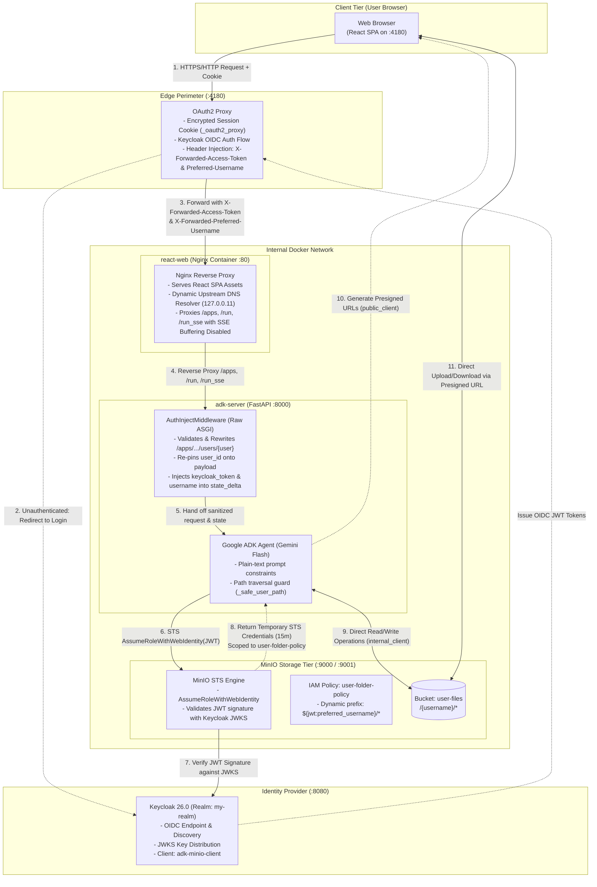

# System Architecture: ADK File Assistant with Keycloak OIDC & MinIO STS

## 1. Executive Summary

The **ADK File Assistant** is a multi-tenant personal file management system powered by **Google ADK (Agent Development Kit)** and **Gemini 2.5/3.5 Flash**, backed by **MinIO Object Storage**, authenticated via **Keycloak (OpenID Connect)**, and secured by **OAuth2 Proxy**.

The central architectural innovation of this project is its **Zero-Trust Storage Isolation** model. Instead of giving the AI assistant master/admin storage credentials and trusting application code or LLM prompt guardrails to isolate tenant data, isolation is enforced cryptographically at the storage layer via **MinIO Security Token Service (STS)** (`AssumeRoleWithWebIdentity`). The LLM and backend never hold root storage keys; every S3 operation is signed using temporary STS credentials dynamically scoped to `user-files/${jwt:preferred_username}/*`.

---

## 2. High-Level Architecture Diagram



---

## 3. Core Components & Responsibilities

| Component | Technology | Role & Key Responsibilities |
|---|---|---|
| **Identity Provider** | Keycloak 26.0 | Centralized OIDC identity provider. Manages realms, users (e.g. `alice`), credentials, and issues cryptographically signed JWT tokens with claims (`preferred_username`, `aud`, `iss`). Exposes JWKS endpoints for token verification. |
| **Edge Perimeter Proxy** | OAuth2 Proxy 7.7.1 | Sits at edge port `4180`. Intercepts all browser traffic, initiates OIDC authentication with Keycloak, manages HTTP-only encrypted session cookies, and injects validated `X-Forwarded-Access-Token` and `X-Forwarded-Preferred-Username` into upstream requests. |
| **Frontend & Web Gateway** | React 18 + Vite + Nginx | Single Page Application providing chat interface and suggestion chips. Served by Nginx, which also acts as a streaming-friendly reverse proxy forwarding `/apps`, `/run`, and `/run_sse` to `adk-server:8000`. |
| **Agent Orchestrator** | Google ADK + FastAPI + Uvicorn | Hosts the Google ADK runtime running Gemini Flash. Implements raw ASGI `AuthInjectMiddleware` to enforce caller identity pinning and populate agent tool context state. Runs 6 specialized MinIO file tools. |
| **Object Storage & STS** | MinIO + MinIO Client (`mc`) | S3-compatible storage with built-in STS. Validates user JWTs directly via Keycloak OpenID configuration and attaches dynamic IAM policy templates based on `${jwt:preferred_username}`. |

---

## 4. Security & Isolation Architecture

### 4.1. The Confused Deputy Problem in AI Agents
In traditional architectures, backends use superuser S3 credentials (`minioadmin`), trusting prompt instructions (e.g., *"only access files for user X"*) or application code filters. If an attacker performs prompt injection or path tampering (e.g. `../../bob/passwords.txt`), a privileged backend will execute it.

### 4.2. Defense-in-Depth: The Three Enforcement Boundaries

```mermaid
flowchart LR
    subgraph B1["Boundary 1: Perimeter"]
        direction TB
        P1["OAuth2 Proxy"]
        P2["Session Cookie Validation"]
        P3["Strips untrusted auth headers"]
    end

    subgraph B2["Boundary 2: Application Gateway"]
        direction TB
        A1["AuthInjectMiddleware (FastAPI)"]
        A2["Rewrites user segment & user_id"]
        A3["Path traversal guard (_safe_user_path)"]
    end

    subgraph B3["Boundary 3: Cryptographic Storage"]
        direction TB
        S1["MinIO STS Engine"]
        S2["AssumeRoleWithWebIdentity"]
        S3["IAM Policy: ${jwt:preferred_username}/*"]
    end

    B1 ==> B2 ==> B3
```



1. **Boundary 1 (Perimeter - OAuth2 Proxy):**
   - The browser never handles raw access tokens or client secrets.
   - All inbound requests must present a valid `_oauth2_proxy` session cookie.
   - Client-supplied authorization headers are stripped and replaced with verified server-side headers (`X-Forwarded-Access-Token`, `X-Forwarded-Preferred-Username`).

2. **Boundary 2 (Application Layer - `adk-server/main.py` & `agent.py`):**
   - **Path & Body Re-Pinning:** `AuthInjectMiddleware` intercepts requests and replaces the user segment in `/apps/{app}/users/{user}/sessions` and the `user_id` field in `/run` and `/run_sse` with the verified username. A caller cannot impersonate another tenant by spoofing body parameters.
   - **State Delta Injection:** Injects `keycloak_token` and `username` into `state_delta` so agent tools receive user credentials inside `tool_context.state`.
   - **Path Normalization:** `_safe_user_path()` strips leading slashes, eliminates redundant user prefixes, and verifies via `posixpath.normpath` that no `../` traversal escapes the user folder.

3. **Boundary 3 (Storage Infrastructure - MinIO STS & IAM Policy):**
   - Every file tool calls `sts.assume_role_with_web_identity` with the user's Keycloak JWT.
   - MinIO contacts Keycloak's `.well-known/openid-configuration` and JWKS to cryptographically verify the signature.
   - MinIO returns temporary credentials (15-minute expiration) governed by `user-folder-policy.json`:
     ```json
     {
       "Version": "2012-10-17",
       "Statement": [
         {
           "Effect": "Allow",
           "Action": ["s3:GetBucketLocation"],
           "Resource": "arn:aws:s3:::user-files"
         },
         {
           "Effect": "Allow",
           "Action": ["s3:ListBucket"],
           "Resource": "arn:aws:s3:::user-files",
           "Condition": {
             "StringLike": {
               "s3:prefix": ["${jwt:preferred_username}/*"]
             }
           }
         },
         {
           "Effect": "Allow",
           "Action": ["s3:GetObject", "s3:PutObject", "s3:DeleteObject"],
           "Resource": "arn:aws:s3:::user-files/${jwt:preferred_username}/*"
         }
       ]
     }
     ```
   - Even if the application logic or LLM is completely compromised, MinIO itself will reject any attempt to access another user's prefix with `403 AccessDenied`.

---

## 5. Dual-Client Pattern for S3 Presigned URLs

A key networking challenge in containerized architectures is dual DNS visibility:
- **Internal Network:** `adk-server` communicates with MinIO at `http://minio:9000`.
- **External Network:** The user's browser communicates with MinIO at `http://localhost:9000`.

If presigned URLs were minted using the internal endpoint, browser requests would fail with hostname lookup errors. If the backend initialized its client with `localhost:9000`, backend calls from inside the container would fail.

### Solution: Dual Client Instantiation
In `adk-server/my_agent/agent.py`:
- `internal_client = Minio(MINIO_ENDPOINT, ...)` (e.g. `minio:9000`): Used for backend-directed operations (`list_objects`, `put_object`, `get_object`, `remove_object`).
- `public_client = Minio(MINIO_PUBLIC_ENDPOINT, ...)` (e.g. `localhost:9000`): Used exclusively to sign upload (`presigned_put_object`) and download (`presigned_get_object`) URLs for direct browser interaction.

---

## 6. End-to-End Request & Data Flow

```mermaid
sequenceDiagram
    autonumber
    actor User as Browser (React UI)
    participant Proxy as OAuth2 Proxy (:4180)
    participant KC as Keycloak (:8080)
    participant Nginx as Nginx (:80)
    participant ADK as FastAPI (Auth Middleware)
    participant Agent as Google ADK Agent (Gemini)
    participant MinIO as MinIO STS & Storage (:9000)

    User->>Proxy: GET / (Initial Visit)
    Proxy->>User: 302 Redirect to Keycloak Login
    User->>KC: Enter credentials (alice / password123)
    KC-->>Proxy: Authorization code & Token Exchange
    Proxy-->>User: Set-Cookie: _oauth2_proxy (Encrypted Session)

    User->>Proxy: POST /run_sse (User prompt: "List my files")
    Note over Proxy: Validates cookie; injects X-Forwarded-Access-Token & Preferred-Username
    Proxy->>Nginx: Forward request with auth headers
    Nginx->>ADK: Proxy pass to http://adk-server:8000/run_sse

    Note over ADK: AuthInjectMiddleware:<br/>1. Verifies token presence/signature<br/>2. Rewrites user_id="alice"<br/>3. Injects token into state_delta
    ADK->>Agent: Invoke Agent Execution with Gemini

    Agent->>MinIO: STS AssumeRoleWithWebIdentity(WebIdentityToken=JWT)
    MinIO->>KC: Validate JWT against JWKS / Discovery
    MinIO-->>Agent: Temporary AccessKey, SecretKey, SessionToken (15m)

    Agent->>MinIO: S3 ListObjects(Bucket="user-files", Prefix="alice/")
    MinIO-->>Agent: Object listing for "alice/*"
    Agent-->>ADK: Format plain text response

    ADK-->>Nginx: SSE Stream (partial=true deltas, then partial=false full)
    Nginx-->>Proxy: Chunked SSE Stream
    Proxy-->>User: Render streaming response in chat interface
```

---

## 7. SSE Streaming & Frontend Protocol Handling

The application leverages Server-Sent Events (SSE) via `/run_sse` for real-time model streaming:

1. **Nginx SSE Buffering Configuration (`react-web/nginx.conf`):**
   - `proxy_buffering off;` and `proxy_cache off;` prevent Nginx from holding chunks.
   - `proxy_read_timeout 300s;` prevents premature disconnects during long tool executions.
   - `resolver 127.0.0.11 valid=10s ipv6=off;` dynamically resolves `adk-server` IP to avoid `502 Bad Gateway` after container rebuilds.
2. **ADK Event Protocol Contract:**
   - **Streaming Deltas:** Events with `partial: true` contain text deltas. The frontend appends these incrementally.
   - **Turn Completion:** The turn ends with an event where `partial: false` containing the **full aggregate text**.
3. **Frontend Re-render Deduplication (`react-web/src/adkStream.ts` & `chatBox.tsx`):**
   - The React client streams tokens via `onToken(delta)`.
   - On the final event, it triggers `onFinal(fullText)` which replaces the message text rather than appending, preventing the duplicate response bug (`Hello! Hello!`).

---

## 8. Directory & File Structure Map

```text
.
├── .env                              # Environment secrets (GOOGLE_GENAI_API_KEY)
├── docker-compose.yaml               # Orchestrates keycloak, minio, minio-init, react-web, adk-server, oauth2-proxy
├── oauth2-proxy.cfg                  # OAuth2 Proxy provider, cookie secrets, and header pass settings
├── user-folder-policy.json           # MinIO IAM policy with dynamic ${jwt:preferred_username} condition
├── README.md                         # Quickstart setup and verification guide
├── article.md                        # Architectural deep-dive & 9 battle-tested engineering lessons
├── architecture.md                   # Formal architectural specification (this document)
├── keycloak/
│   └── my-realm.json                 # Pre-configured realm with client and test user (alice)
├── adk-server/
│   ├── Dockerfile                    # Python 3.12 slim container
│   ├── requirements.txt              # google-adk, fastapi, uvicorn, boto3, minio, pyjwt
│   ├── main.py                       # ASGI AuthInjectMiddleware, API-key bridge, CORS, FastAPI app
│   └── my_agent/
│       ├── __init__.py
│       └── agent.py                  # Agent definition, plain-text instructions, MinIO tools & STS client
└── react-web/
    ├── Dockerfile                    # Multi-stage: Node 20 build -> Nginx alpine
    ├── nginx.conf                    # Nginx reverse proxy with SSE support and dynamic resolver
    ├── package.json                  # React 18, Vite, TypeScript
    ├── vite.config.ts
    └── src/
        ├── App.tsx                   # Main layout, Keycloak SSO sign-out, session generation
        ├── chatBox.tsx               # Chat UI, suggestion chips, message history
        └── adkStream.ts              # SSE client parser, session ensure (handling 409s), delta handling
```

---

## 9. Key Engineering Lessons Learned

1. **Avoid `BaseHTTPMiddleware` for Request Body Patches:** Starlette's `BaseHTTPMiddleware` buffers request bodies internally. Patches to `_receive` are ignored and break SSE disconnect detection. Use raw ASGI middleware with a custom replay generator.
2. **Handle Middleware Exceptions Gracefully:** Raising `HTTPException` inside raw ASGI middleware bypasses FastAPI exception handlers and returns `500 Internal Server Error`. Return explicit `JSONResponse(status_code=401)` objects instead.
3. **Account for S3 Client Preflights:** The official `minio` Python SDK executes `s3:GetBucketLocation` prior to object actions. Bucket-level policies must grant `s3:GetBucketLocation` on the bucket root or all operations fail with `AccessDenied`.
4. **MinIO Role ARN Format:** MinIO STS requires partition `minio` (`arn:minio:iam:::role/<hash>`), derived deterministically from the policy name configured in `MINIO_IDENTITY_OPENID_ROLE_POLICY`.
5. **Dynamic Upstream Resolution in Nginx:** Using `set $adk_upstream http://adk-server:8000;` alongside Docker DNS (`127.0.0.11 valid=10s`) prevents stale IP caching and `502 Bad Gateway` after container restarts.
