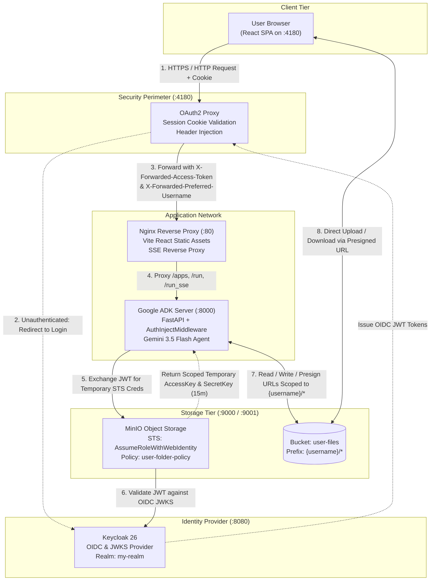
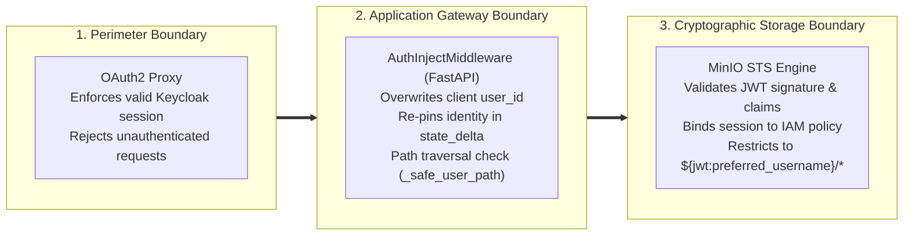

# Architecting a Zero-Trust AI File Assistant: Google ADK, Keycloak OIDC, and MinIO STS in Practice

*How to solve the Confused Deputy problem in LLM tool calling by enforcing isolation at the storage layer — and the nine battle-tested engineering lessons learned along the way.*

---

## 1. Introduction: The Agent Security Dilemma

When designing an AI assistant capable of file management, developers typically reach for the standard recipe: give an LLM framework a set of tools backed by an S3 SDK initialized with admin credentials (`AWS_ACCESS_KEY_ID` / `AWS_SECRET_ACCESS_KEY`), and write application code to filter files by user ID:

```python
# The Traditional (Vulnerable) Pattern:
def list_files(user_id: str):
    # Relies entirely on application logic and LLM prompt compliance
    return s3.list_objects_v2(Bucket="all-user-data", Prefix=f"{user_id}/")
```

In an agentic system, this pattern is dangerous. Large Language Models are probabilistic reasoning engines, susceptible to **prompt injection**, **jailbreaking**, and **hallucination**. If an attacker tricks the model into executing `read_file(path="../bob/financials.pdf")` or `list_files(user_id="admin")`, a backend armed with superuser S3 credentials will happily execute the command. The agent becomes a **Confused Deputy** — a privileged entity coerced into misusing its authority.

To build a genuinely multi-tenant, secure AI file assistant, we must enforce **Zero Trust**:

1. The AI agent and the application backend must **never possess master storage credentials**.
2. File isolation must be enforced cryptographically at the **storage infrastructure layer**, completely independent of application code or LLM prompts.
3. Credentials passed to the agent tools must be **short-lived**, dynamically minted, and strictly bound to the authenticated user's identity.

This repository demonstrates a production-grade architecture that achieves this by combining **Google ADK (Agent Development Kit)**, **Keycloak OIDC**, **OAuth2 Proxy**, and **MinIO STS (`AssumeRoleWithWebIdentity`)**.

---

## 2. System Architecture & Request Lifecycle

The application consists of five loosely coupled services orchestrated through Docker Compose:



### Component Roles

| Service | Technology | Responsibility |
| --- | --- | --- |
| **Identity Provider** | Keycloak 26.0 | Issues OpenID Connect (OIDC) JWTs containing user identities (`preferred_username`). |
| **Edge Reverse Proxy** | OAuth2 Proxy 7.7 | Protects the perimeter. Manages encrypted session cookies, validates login state with Keycloak, and injects JWTs downstream via HTTP headers. |
| **Frontend Web** | React 18 + Vite + Nginx | Serves the user interface and proxies API calls (`/apps`, `/run`, `/run_sse`) through Nginx with streaming optimizations. |
| **AI Orchestrator** | Google ADK + FastAPI | Hosts the agent runtime powered by Gemini 3.5 Flash. Normalizes incoming identity via ASGI middleware and invokes MinIO tools. |
| **Storage Engine** | MinIO + STS | S3-compatible storage. Validates OIDC JWTs directly and applies dynamic IAM policies to mint short-lived credentials scoped to `${jwt:preferred_username}/*`. |

---

## 3. Defense-in-Depth: The Three Enforcement Boundaries

True isolation requires multiple redundant boundaries so that a failure in one layer cannot breach tenant boundaries.



### Boundary 1: OAuth2 Proxy Perimeter

The frontend never holds or manages raw authentication tokens. When the user logs in, OAuth2 Proxy stores the access token inside an encrypted, HTTP-only session cookie (`_oauth2_proxy`). Every incoming request to upstream services is stripped of client-supplied authentication headers and injected with verified server-side headers:

* `X-Forwarded-Access-Token`: The raw Keycloak OIDC JWT.
* `X-Forwarded-Preferred-Username`: The user's verified identity (e.g., `alice`).

### Boundary 2: ASGI Identity Pinning & Path Normalization

Even if an attacker bypasses the frontend or crafts custom HTTP requests, the ADK FastAPI server runs a custom ASGI middleware (`AuthInjectMiddleware`). This middleware:

1. Validates the presence of `X-Forwarded-Access-Token` and optionally verifies the signature against Keycloak's JWKS endpoint.
2. Extracts the verified username and **rewrites** the request path (`/apps/{app}/users/{user}/...`) and the JSON request body (`user_id = username`).
3. Injects the JWT and username into the agent's `state_delta` dictionary, making it accessible to the agent's tool execution context.
4. Enforces application-level path normalization in `_safe_user_path()`, preventing directory traversal attacks like `../../` before any S3 call is made.

### Boundary 3: The Cryptographic Storage Boundary (The Core)

This is the heart of the system. In `adk-server/my_agent/agent.py`, whenever the agent executes a file tool, it makes an STS call:

```python
response = sts.assume_role_with_web_identity(
    RoleArn=MINIO_ROLE_ARN,
    RoleSessionName=f"adk-{username}"[:64],
    WebIdentityToken=jwt_token,
    DurationSeconds=900,  # 15 minutes
)
```

MinIO contacts Keycloak's `.well-known/openid-configuration` endpoint, validates the JWT, and mints temporary credentials bound to `user-folder-policy.json`:

```json
{
  "Version": "2012-10-17",
  "Statement": [
    {
      "Effect": "Allow",
      "Action": ["s3:GetBucketLocation"],
      "Resource": "arn:aws:s3:::user-files"
    },
    {
      "Effect": "Allow",
      "Action": ["s3:ListBucket"],
      "Resource": "arn:aws:s3:::user-files",
      "Condition": {
        "StringLike": {
          "s3:prefix": ["${jwt:preferred_username}/*"]
        }
      }
    },
    {
      "Effect": "Allow",
      "Action": ["s3:GetObject", "s3:PutObject", "s3:DeleteObject"],
      "Resource": "arn:aws:s3:::user-files/${jwt:preferred_username}/*"
    }
  ]
}
```

Notice `${jwt:preferred_username}`. MinIO dynamically interpolates the claim directly from the token signature. Even if the agent were manipulated into requesting `s3://user-files/bob/secret.txt` on behalf of `alice`, MinIO rejects the operation with `403 AccessDenied`. **The storage engine itself makes it mathematically impossible to access another user's files.**

---

## 4. The Dual-Client Pattern for Presigned URLs

A subtle architectural challenge arises when deploying S3 storage inside Docker networks:

* **Internal Traffic:** `adk-server` communicates with MinIO over the Docker bridge network via internal DNS: `http://minio:9000`.
* **External Traffic:** The user's browser runs on the host machine and communicates via `http://localhost:9000` (or a public domain).

If the agent generates a presigned download or upload URL using the standard internal MinIO client, the resulting URL points to `http://minio:9000/...`. When the browser attempts to fetch or upload to this URL, DNS resolution fails because `minio` does not exist on the user's host machine.

Conversely, if the agent initializes its MinIO client using `localhost:9000`, the server container cannot reach MinIO because `localhost` refers to the `adk-server` container itself!

### The Solution: Separate Execution and Presigning Clients

In `adk-server/my_agent/agent.py`, we construct two distinct client instances from the same temporary STS credentials:

```python
# 1. Internal Client: Used by the server for direct reads and writes
internal_client = Minio(
    MINIO_ENDPOINT,  # "minio:9000"
    access_key=creds["AccessKeyId"],
    secret_key=creds["SecretAccessKey"],
    session_token=creds["SessionToken"],
    secure=MINIO_USE_SSL,
)

# 2. Public Client: Used exclusively for calculating presigned URLs
public_client = Minio(
    MINIO_PUBLIC_ENDPOINT,  # "localhost:9000"
    access_key=creds["AccessKeyId"],
    secret_key=creds["SecretAccessKey"],
    session_token=creds["SessionToken"],
    region="us-east-1",
    secure=MINIO_USE_SSL,
)
```

Direct operations (`put_object`, `get_object`, `list_objects`) execute over `internal_client`. When the user requests a download or upload link, `public_client.presigned_get_object()` or `presigned_put_object()` signs the URL using the public endpoint. The browser can then directly upload or download multi-gigabyte files to MinIO without proxying heavy binary data through the Python application tier.

---

## 5. The Engineering Bug Log: 9 Real-World Battle Scars

Connecting a modern LLM agent framework to an enterprise identity provider and an S3 storage engine reveals edge cases that documentation rarely mentions. Here are the nine major bugs encountered during implementation and how they were solved.

---

### Bug 1: Stale Upstream DNS Caching in Nginx (`502 Bad Gateway`)

**Symptom:**
Whenever the `adk-server` container was rebuilt or restarted (`docker compose up -d adk-server`), all subsequent chat requests from the frontend failed immediately with `502 Bad Gateway`. Restarting Nginx fixed the issue until the next rebuild.

**Root Cause:**
Standard Nginx configuration (`proxy_pass http://adk-server:8000;`) resolves the upstream hostname **exactly once during Nginx startup**. When Docker recreated the `adk-server` container, it assigned a new container IP. Nginx continued dialing the dead IP indefinitely.

**Solution (`react-web/nginx.conf`):**
Assign the upstream URL to a runtime variable and explicitly declare Docker's internal DNS resolver:

```nginx
location ~ ^/(apps|run|run_sse)(/|$) {
    # 127.0.0.11 is Docker's embedded DNS server
    resolver 127.0.0.11 valid=10s ipv6=off;
    set $adk_upstream http://adk-server:8000;
    proxy_pass $adk_upstream;
    ...
}
```

Using a variable (`$adk_upstream`) forces Nginx to query the resolver every `valid=10s`, allowing seamless zero-downtime container updates.

---

### Bug 2: ADK Origin Gate Rejection (`403 Forbidden`)

**Symptom:**
Requests routed through OAuth2 Proxy (`http://localhost:4180`) were rejected by the Google ADK FastAPI server with `403 Forbidden`.

**Root Cause:**
Google ADK includes an internal security check comparing the incoming `Origin` header against the `Host` header. Two separate issues caused this to fail:

1. ADK's `allow_origins` parameter was not configured with the proxy's URL.
2. In Nginx, using `proxy_set_header Host $host;` stripped the port number. The incoming Origin was `http://localhost:4180`, but ADK received a Host header of `localhost` without `:4180`.

**Solution:**

1. Pass allowed origins into `get_fast_api_app`:

   ```python
   app = get_fast_api_app(
       agents_dir=".",
       allow_origins=ALLOWED_ORIGINS,  # ["http://localhost:4180", ...]
       web=False,
   )
   ```

2. In `nginx.conf`, switch from `$host` to `$http_host` (which preserves the port):

   ```nginx
   proxy_set_header Host $http_host;
   ```

---

### Bug 3: `BaseHTTPMiddleware` Caching Breaks Body Rewriting & Streaming

**Symptom:**
Attempting to rewrite the JSON body in a standard Starlette `BaseHTTPMiddleware` resulted in either the original body being forwarded anyway, or a crash on `/run_sse`:

```text
RuntimeError: Unexpected message received: http.request
```

**Root Cause:**
`BaseHTTPMiddleware` caches `request.body()`. If you read the body in middleware, Starlette buffers it in memory and forwards the *cached* bytes downstream regardless of modifications to `request._receive`. Furthermore, patching `_receive` breaks the disconnect handshake required by SSE streaming responses.

**Solution (`adk-server/main.py`):**
Implement `AuthInjectMiddleware` as a **raw ASGI middleware** with a dedicated replay generator:

```python
def _single_body_receive(body: bytes, fallback: Receive) -> Receive:
    sent = False

    async def receive() -> Message:
        nonlocal sent
        if not sent:
            sent = True
            return {"type": "http.request", "body": body, "more_body": False}
        return await fallback()

    return receive
```

The middleware drains the initial request body, modifies `user_id` and `state_delta`, and provides a custom `receive()` that emits the modified body on the first call and then delegates directly to the underlying socket for genuine disconnect notifications.

---

### Bug 4: Starlette Middleware Exception Masking (`500` instead of `401`)

**Symptom:**
When an unauthenticated request reached `adk-server` without an access token, the client received `500 Internal Server Error` instead of `401 Unauthorized`.

**Root Cause:**
In ASGI/Starlette middleware, executing `raise HTTPException(status_code=401)` does not trigger FastAPI's exception handlers; it escapes the middleware stack unhandled, causing the ASGI server (Uvicorn) to catch it as an unhandled server crash and return HTTP 500.

**Solution:**
Return a raw `JSONResponse` directly without raising an exception:

```python
def _unauthorized(detail: str) -> JSONResponse:
    return JSONResponse(status_code=401, content={"detail": detail})
```

---

### Bug 5: Premature Disconnect in SSE Body Replay

**Symptom:**
The frontend connected to `/run_sse`, received an HTTP 200 header, and immediately completed with zero stream events or tokens.

**Root Cause:**
In an earlier version of the custom `receive()` channel, once the modified body was returned, the second call returned `{"type": "http.disconnect"}`. Starlette's `StreamingResponse` runs a background task that listens for disconnects concurrently. Receiving an immediate disconnect message canceled the generator before the Gemini model produced its first token.

**Solution:**
As shown in Bug 3, after yielding the single `http.request` message, the replay channel must delegate to `fallback()` (the genuine client socket). The genuine socket remains open until the user actually closes their browser tab.

---

### Bug 6: Starlette Middleware Registration Order & CORS

**Symptom:**
When a 401 Unauthorized error occurred, browser fetch requests failed with a cross-origin error (`No 'Access-Control-Allow-Origin' header is present on the requested resource`), hiding the true 401 status.

**Root Cause:**
Starlette's `app.add_middleware()` **prepends** each new middleware to the stack. The last middleware added becomes the outermost layer that processes requests first and responses last.

```python
# INCORRECT:
app.add_middleware(CORSMiddleware, ...)
app.add_middleware(AuthInjectMiddleware)  # Runs outside CORS! 401 responses lack CORS headers.
```

**Solution:**
Register `AuthInjectMiddleware` first, and `CORSMiddleware` second, ensuring CORS headers wrap all responses (including 401s):

```python
# CORRECT:
app.add_middleware(AuthInjectMiddleware)
app.add_middleware(
    CORSMiddleware,
    allow_origins=ALLOWED_ORIGINS,
    allow_credentials=True,
    allow_methods=["*"],
    allow_headers=["*"],
)
```

---

### Bug 7: MinIO STS Role Partition & Hash Discovery

**Symptom:**
Calling `assume_role_with_web_identity` failed with:

```text
An error occurred (InvalidParameterValue) when calling the AssumeRoleWithWebIdentity operation:
Error processing RoleArn parameter: RoleARN parse err: invalid ARN - bad partition field
```

**Root Cause:**
Standard AWS IAM role ARNs use the partition `arn:aws:iam:::role/...`. MinIO parses ARNs using its own internal rules and requires the partition `minio`: `arn:minio:iam:::role/...`. Furthermore, MinIO does not support arbitrary role names; it hashes the policy name specified in `MINIO_IDENTITY_OPENID_ROLE_POLICY` on boot.

**Solution:**

1. Configure MinIO with `MINIO_IDENTITY_OPENID_ROLE_POLICY="user-folder-policy"`.
2. Inspect the MinIO container startup logs to extract the generated role ARN:

   ```bash
   docker compose logs minio | grep "IAM Roles"
   # Output: INFO: IAM Roles: arn:minio:iam:::role/ivd6H_TwNAxH9YkB81tz8yJe_Jk
   ```

3. Set `MINIO_ROLE_ARN` in `adk-server` to this exact ARN. The hash is deterministic across container restarts as long as the policy name remains unchanged.

---

### Bug 8: The Hidden `GetBucketLocation` SDK Preflight

**Symptom:**
STS credentials were successfully obtained, and raw AWS CLI / Boto3 commands succeeded, but every call made using the official `minio` Python SDK failed:

```text
S3 operation failed; code: AccessDenied, message: Access Denied., resource: /user-files
```

**Root Cause:**
The official `minio` Python SDK executes an automatic `s3:GetBucketLocation` (region discovery) call against the target bucket before executing any operation (`list_objects`, `put_object`, etc.). The original IAM policy only granted permissions on `${jwt:preferred_username}/*`. Because the region discovery call failed, the SDK aborted the request before even attempting the file operation.

**Solution:**
Add an explicit statement in `user-folder-policy.json` allowing `s3:GetBucketLocation` at the bucket level:

```json
{
  "Effect": "Allow",
  "Action": ["s3:GetBucketLocation"],
  "Resource": "arn:aws:s3:::user-files"
}
```

---

### Bug 9: Duplicate Assistant Responses & SSE Event Contracts

**Symptom:**
In the chat interface, every assistant response rendered twice (e.g., `Hello! Hello!`).

**Root Cause:**
The Google ADK `/run_sse` endpoint follows a dual-phase event protocol:

1. Streaming tokens are emitted as events where `partial: true` containing text chunks (deltas).
2. Upon completion of the turn, ADK emits a final event where `partial: false` containing the **entire aggregated response text**.

The frontend stream handler was appending all events unconditionally:

```ts
// INCORRECT:
setReply((prev) => prev + eventText);
```

**Solution (`react-web/src/adkStream.ts` & `chatBox.tsx`):**
Differentiate between deltas and full turn replacements:

```ts
if (payload?.partial === true) {
  // Streaming delta: append token
  for (const text of texts) callbacks.onToken(text);
} else {
  // Final event: replace entire message content with authoritative text
  const fullText = texts.join("");
  callbacks.onFinal ? callbacks.onFinal(fullText) : callbacks.onToken(fullText);
}
```

*(Bonus Bug: Google ADK specifically expects `GOOGLE_API_KEY` or `GEMINI_API_KEY`. It completely ignores `GOOGLE_GENAI_API_KEY`. A three-line fallback bridge was added to `main.py` to map `GOOGLE_GENAI_API_KEY` into `GOOGLE_API_KEY` when set).*

---

## 6. End-to-End Verification Matrix

To ensure that the isolation model works under adversarial conditions, the system was validated through automated checks and security tests:

| Test Scenario | Method | Expected Result | Actual Result |
| --- | --- | --- | --- |
| **Legitimate File Creation** | Agent prompt: *"Create notes.txt"* | File created under `user-files/alice/notes.txt` | ✅ Created (200 OK) |
| **Direct Object Verification** | Direct MinIO listing with admin credentials | Inspect physical S3 storage layout | ✅ Verified at `alice/notes.txt` |
| **Cross-Tenant Read Attack** | Python script assuming `alice` STS credentials to read `bob/secret.txt` | MinIO rejects operation | ✅ `403 AccessDenied` |
| **Forged Body User ID** | Client sends `POST /run_sse` with `user_id: "admin"` | Middleware overwrites `user_id` to `alice` | ✅ Overwritten server-side |
| **Path Traversal Attack** | Agent tool invoked with `filename: "../../etc/passwd"` | Rejected by `_safe_user_path` | ✅ `ValueError: Invalid file path` |
| **Missing OIDC Token** | Direct curl to `adk-server:8000/run` | Middleware returns 401 | ✅ `401 Unauthorized` |
| **Foreign Origin Check** | Browser request from unauthorized origin | ADK origin gate rejects | ✅ `403 Forbidden` |
| **Session Isolation** | User Alice attempting to join User Bob's session ID | Session lookup under `alice` namespace | ✅ `404 Not Found` |

---

## 7. How to Run the Stack Locally

### Prerequisites

* Docker and Docker Compose
* A Google Gemini API Key (`AIza...`)

### 1. Clone & Configure Environment

Create a `.env` file in the project root:

```bash
GOOGLE_GENAI_API_KEY=AIzaSyYourGeminiApiKeyHere
```

Generate a secure cookie secret for `oauth2-proxy.cfg`:

```bash
python3 -c 'import os,base64; print(base64.urlsafe_b64encode(os.urandom(32)).decode())'
```

Update `oauth2-proxy.cfg` with your generated `cookie_secret`.

### 2. Launch Services

```bash
docker compose up --build -d
```

The initialization sequence will automatically:

1. Start Keycloak and import `keycloak/my-realm.json` (preconfigured with test user `alice` / `password123`).
2. Start MinIO and run `minio-init` to provision the `user-files` bucket and apply `user-folder-policy.json`.
3. Launch `adk-server`, `react-web`, and `oauth2-proxy`.

### 3. Verify the Deployment

1. Navigate to `http://localhost:4180` in your browser.
2. Sign in via Keycloak using:
   * **Username:** `alice`
   * **Password:** `password123`
3. Try issuing file management commands in the chat interface:
   * *"Create a file named hello.txt with content Hello from ADK"*
   * *"List all my files"*
   * *"Read the content of hello.txt"*
   * *"Delete hello.txt"*
   * *"Get a download link for hello.txt"*
4. Open the MinIO Web Console at `http://localhost:9001` (`minioadmin` / `minioadmin_password`) to observe that `hello.txt` is physically stored under the `alice/` prefix inside the `user-files` bucket.

---

## 8. Key Takeaways for AI System Designers

1. **Never trust application code to isolate tenant data when LLMs have tool execution capabilities.** If an agent has access to an unrestricted backend client, prompt injection can turn the agent into a Confused Deputy. Push authorization down to the database or storage engine.
2. **Dynamic IAM Policy Templates are powerful.** By using `${jwt:preferred_username}`, MinIO derives authorization directly from the cryptographically signed claims of the OIDC token. No administrative provisioning is required when onboarding new users.
3. **Be mindful of ASGI Middleware semantics.** If you must rewrite request bodies or user identities for streaming endpoints (SSE / WebSockets), avoid Starlette's `BaseHTTPMiddleware`. Work directly with ASGI `scope`, `receive`, and `send` primitives to prevent broken streaming connections and request body caching bugs.
4. **Enforce plain-text response constraints when necessary.** When building AI assistants for clean embedded terminal or chat displays, explicitly prompt the model to avoid markdown symbols (`*`, `#`, `` ` ``). This eliminates inconsistent syntax parsing during streaming chunk renders.
5. **Beware of SDK preflight operations.** Object storage client libraries often execute hidden management calls (such as `GetBucketLocation`). Ensure your IAM policies explicitly account for these housekeeping calls, or risk confusing `AccessDenied` errors despite correct object-level permissions.
6. **Separate internal and public S3 clients in containerized environments.** When generating presigned URLs for client browsers, always sign URLs using the browser-accessible endpoint rather than internal Docker service discovery hostnames.

---

*The full source code, deployment scripts, and configuration files are available in this repository.*
