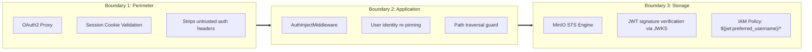
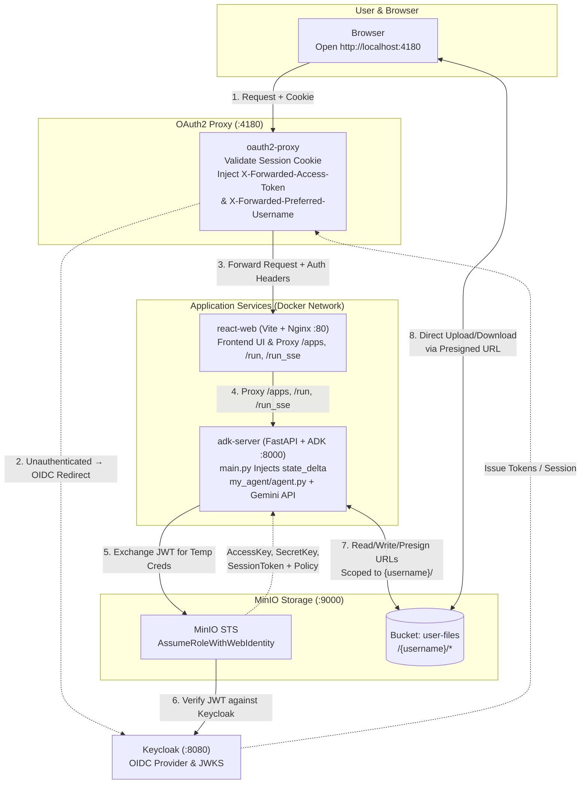
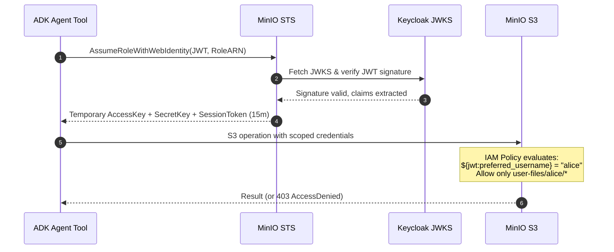
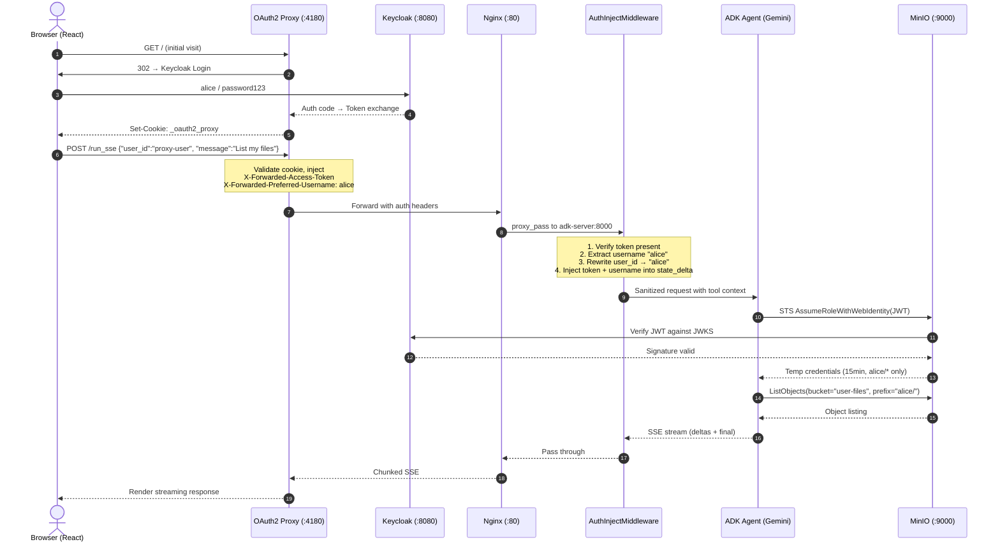

# Building a Zero-Trust AI File Assistant with Google ADK, MinIO STS, and Keycloak

**How to make an LLM-powered agent provably unable to access another user's files — enforced by the storage layer, not by prompt instructions.**

---

## Introduction

Large Language Model agents are increasingly granted access to real infrastructure — databases, file storage, APIs. But the moment you hand an agent a set of privileged credentials and say *"only access files for the current user,"* you've created a **confused deputy**: a single prompt injection, path traversal, or application bug away from leaking every tenant's data.

This article walks through the architecture and implementation of a **personal file management assistant** that eliminates this class of vulnerability entirely. Instead of trusting application code or LLM guardrails to enforce tenant isolation, we push the security boundary down to the storage layer itself using **MinIO Security Token Service (STS)** and **Keycloak-issued JWTs**.

The result: a system where the AI agent literally *cannot* read, write, or list another user's files — not because the code says so, but because the cryptographic credentials it holds don't permit it.

### What We're Building

A chat-based file assistant where authenticated users can:
- List, create, read, and delete text files in their personal storage directory
- Generate presigned upload/download URLs for direct browser-to-storage transfers
- Interact naturally through a Gemini-powered conversational agent

All running as six Docker containers orchestrated with `docker-compose`:

| Service | Technology | Port |
|---|---|---|
| Identity Provider | Keycloak 26.0 | `:8080` |
| Edge Auth Proxy | OAuth2 Proxy 7.7.1 | `:4180` |
| Object Storage | MinIO | `:9000` / `:9001` |
| Agent Backend | Google ADK + FastAPI | `:8000` |
| Frontend | React 19 + Vite + Nginx | `:80` |
| Init Job | MinIO Client (`mc`) | — |

---

## The Problem: Why "Just Check the User" Isn't Enough

Consider the typical architecture for a multi-tenant AI file assistant:

```
User → Backend (admin S3 credentials) → S3 Storage
                 ↑
         "Only access files for user X"
         (enforced by prompt + app code)
```

This model has three failure modes:

1. **Prompt Injection:** An attacker crafts input that tricks the LLM into calling `list_objects(prefix="admin/secrets/")` or `get_object("../../bob/passwords.txt")`.
2. **Path Traversal:** Even without LLM involvement, a malformed filename like `../other-user/private.txt` can escape the intended directory if the application doesn't normalize paths correctly.
3. **Application Bugs:** A logic error in the middleware, a missing authorization check on a new endpoint, or a race condition in session handling can silently grant access to the wrong user's data.

In all three cases, the backend holds admin-level S3 credentials. The *only* thing preventing cross-tenant access is application logic — the very thing that just failed.

---

## The Solution: Three-Boundary Defense in Depth

Our architecture replaces the single trust boundary with three independent enforcement layers. Each layer can stop an unauthorized access attempt on its own, so all three must be compromised simultaneously for a breach to occur.



**Boundary 1 — Perimeter (OAuth2 Proxy):** The browser never handles raw tokens. OAuth2 Proxy manages the OIDC flow with Keycloak, sets an encrypted HTTP-only session cookie, and injects verified identity headers (`X-Forwarded-Access-Token`, `X-Forwarded-Preferred-Username`) server-side.

**Boundary 2 — Application (FastAPI Middleware):** A raw ASGI middleware validates the proxy headers, re-pins the authenticated identity onto every request path and body, and injects the JWT into the agent's tool context. Even if the React client sends a spoofed `user_id`, the middleware overwrites it.

**Boundary 3 — Storage Infrastructure (MinIO STS):** The agent never holds admin credentials. Instead, it exchanges the user's Keycloak JWT for 15-minute STS credentials scoped to `user-files/${jwt:preferred_username}/*`. MinIO independently verifies the JWT against Keycloak's JWKS endpoint, then enforces the IAM policy at the storage level. Even a fully compromised application server cannot access another user's prefix.

---

## Architecture Overview



---

## Deep Dive: The Authentication Chain

### Step 1 — Keycloak as the Identity Foundation

Keycloak serves as the centralized OpenID Connect provider. A pre-configured realm (`my-realm`) is automatically imported on first boot from `keycloak/my-realm.json`:

```json
{
  "realm": "my-realm",
  "enabled": true,
  "clients": [{
    "clientId": "adk-minio-client",
    "protocol": "openid-connect",
    "publicClient": false,
    "standardFlowEnabled": true,
    "redirectUris": [
      "http://localhost:4180/oauth2/callback"
    ],
    "protocolMappers": [{
      "name": "audience-adk-minio-client",
      "protocolMapper": "oidc-audience-mapper",
      "config": {
        "included.client.audience": "adk-minio-client",
        "access.token.claim": "true"
      }
    }]
  }],
  "users": [{
    "username": "alice",
    "email": "alice@example.com",
    "enabled": true,
    "credentials": [{
      "type": "password",
      "value": "password123",
      "temporary": false
    }]
  }]
}
```

Key design decisions:
- **Audience mapper:** MinIO STS requires the JWT to contain an `aud` claim matching the configured client ID. Without this mapper, `AssumeRoleWithWebIdentity` silently rejects the token.
- **Non-public client:** The client secret is shared between Keycloak and OAuth2 Proxy server-side. The browser never sees it.
- **Brute-force protection enabled:** The realm has `bruteForceProtected: true` to guard against credential stuffing.

### Step 2 — OAuth2 Proxy as the Session Gateway

OAuth2 Proxy sits at the edge on port `4180`, handling the entire OIDC flow so the React app doesn't need any client-side authentication logic:

```ini
# oauth2-proxy.cfg
provider = "keycloak-oidc"
oidc_issuer_url = "http://keycloak:8080/realms/my-realm"
client_id = "adk-minio-client"

cookie_secure = false       # HTTP for local dev
cookie_httponly = true       # No JavaScript access
cookie_samesite = "lax"     # CSRF protection
cookie_refresh = "2m"       # Token refresh interval

pass_access_token = true    # → X-Forwarded-Access-Token
pass_user_headers = true    # → X-Forwarded-Preferred-Username
set_xauthrequest = true     # → X-Auth-Request-* headers

upstreams = ["http://react-web:80/"]
```

The critical configuration here is `pass_access_token = true` combined with `pass_user_headers = true`. This causes OAuth2 Proxy to inject two headers into every upstream request:
- `X-Forwarded-Access-Token`: The raw Keycloak JWT
- `X-Forwarded-Preferred-Username`: The authenticated username extracted from the token

The React app renders behind the proxy at `http://localhost:4180`. Unauthenticated users are automatically redirected to Keycloak's login page. After authentication, the encrypted session cookie (`_oauth2_proxy`) handles all subsequent requests transparently.

### Step 3 — The AuthInjectMiddleware (The Trust Bridge)

This is the most security-critical component. The middleware bridges the gap between the OAuth2 Proxy's identity assertion and Google ADK's session and tool context model.

**Why raw ASGI instead of Starlette's `BaseHTTPMiddleware`?**

This was a hard-won lesson. Starlette's `BaseHTTPMiddleware` calls `request.body()` which caches the original bytes internally. Even if you modify `request._receive`, Starlette forwards the *cached original* downstream, so the body rewrite never reaches the route. Worse, the buffered read corrupts the disconnect handshake for Server-Sent Events, causing `RuntimeError: Unexpected message received: http.request` on `/run_sse`.

The raw ASGI approach solves both problems:

```python
class AuthInjectMiddleware:
    SKIP_PATHS = frozenset({"/docs", "/openapi.json"})
    REWRITTEN_PATHS = frozenset({"/run", "/run_sse"})

    def __init__(self, app: ASGIApp) -> None:
        self.app = app

    async def __call__(self, scope, receive, send):
        if scope["type"] != "http":
            await self.app(scope, receive, send)
            return

        path = scope.get("path", "")
        if scope.get("method") == "OPTIONS" or path in self.SKIP_PATHS:
            await self.app(scope, receive, send)
            return

        headers = _headers_dict(scope)
        token = (headers.get("x-forwarded-access-token") or "").strip()
        if not token:
            await _unauthorized(
                "Missing X-Forwarded-Access-Token from OAuth2 Proxy"
            )(scope, receive, send)
            return
```

The middleware performs four critical operations:

**1. Token Validation:** When `REQUIRE_JWT_SIGNATURE=true`, the token is cryptographically verified against Keycloak's JWKS endpoint. For local development, signature verification can be disabled since OAuth2 Proxy has already validated the token.

**2. Username Extraction:** The username is extracted from `X-Forwarded-Preferred-Username` (set by OAuth2 Proxy) with a fallback to decoding the JWT's `preferred_username` claim:

```python
def _extract_username(headers, token):
    header_user = (
        headers.get("x-forwarded-preferred-username")
        or headers.get("x-forwarded-user")
        or ""
    ).strip()
    if header_user:
        return header_user

    # Fallback: decode claims from JWT
    try:
        claims = jwt.decode(token, options={"verify_signature": False})
        return str(
            claims.get("preferred_username") or claims.get("sub") or ""
        ).strip()
    except Exception:
        return ""
```

**3. Path Re-Pinning:** ADK's session endpoints use the pattern `/apps/{app}/users/{user}/sessions/{id}`. The React client sends a fixed placeholder (`"proxy-user"`) as the user segment, and the middleware rewrites it to the authenticated username:

```python
_USER_SCOPED_PATH = re.compile(
    r"^(?P<prefix>/apps/[^/]+/users/)(?P<user>[^/]+)(?P<suffix>/.*)?$"
)

match = _USER_SCOPED_PATH.match(path)
if match and match.group("user") != username:
    path = f"{match.group('prefix')}{username}{match.group('suffix') or ''}"
    scope["path"] = path
    scope["raw_path"] = path.encode("utf-8")
```

**4. Body Rewriting with State Injection:** For `/run` and `/run_sse` POST requests, the middleware drains the request body, parses it, overwrites `user_id`, and injects the JWT and username into `state_delta`:

```python
payload["user_id"] = username
state_delta = payload.get("state_delta")
if not isinstance(state_delta, dict):
    state_delta = {}
state_delta["keycloak_token"] = token
state_delta["username"] = username
payload["state_delta"] = state_delta
```

The rewritten body is replayed via a custom `Receive` callable that returns the modified bytes once, then defers to the original channel for disconnect detection (critical for SSE):

```python
def _single_body_receive(body, fallback):
    sent = False
    async def receive():
        nonlocal sent
        if not sent:
            sent = True
            return {"type": "http.request", "body": body, "more_body": False}
        return await fallback()
    return receive
```

---

## Deep Dive: MinIO STS and Zero-Trust Storage

### The IAM Policy

The heart of tenant isolation is `user-folder-policy.json`:

```json
{
  "Version": "2012-10-17",
  "Statement": [
    {
      "Effect": "Allow",
      "Action": ["s3:GetBucketLocation"],
      "Resource": "arn:aws:s3:::user-files"
    },
    {
      "Effect": "Allow",
      "Action": ["s3:ListBucket"],
      "Resource": "arn:aws:s3:::user-files",
      "Condition": {
        "StringLike": {
          "s3:prefix": ["${jwt:preferred_username}/*"]
        }
      }
    },
    {
      "Effect": "Allow",
      "Action": ["s3:GetObject", "s3:PutObject", "s3:DeleteObject"],
      "Resource": "arn:aws:s3:::user-files/${jwt:preferred_username}/*"
    }
  ]
}
```

Three things to note:

1. **`s3:GetBucketLocation` on the bucket root** — The MinIO Python SDK issues a `GetBucketLocation` call before any object operation. Without this statement, every tool call fails with `AccessDenied` before it even attempts the real operation. This is an undocumented SDK behavior that cost significant debugging time.

2. **`s3:ListBucket` with prefix condition** — The list operation is allowed only when the request's `s3:prefix` matches `${jwt:preferred_username}/*`. User `alice` can list `alice/*` but cannot enumerate any other prefix.

3. **Dynamic variable `${jwt:preferred_username}`** — MinIO substitutes this with the `preferred_username` claim from the JWT at policy evaluation time. This is not a string replacement in the config — it's evaluated per-request against the STS credentials' source token.

### STS Credential Exchange in the Agent

Each tool call begins with an STS exchange — the agent never holds persistent S3 credentials:

```python
def _get_user_minio_client(tool_context: ToolContext):
    jwt_token = tool_context.state.get("keycloak_token")
    username = tool_context.state.get("username")

    sts = boto3.client(
        "sts",
        endpoint_url=f"{scheme}://{MINIO_ENDPOINT}",
        region_name="us-east-1",
    )

    response = sts.assume_role_with_web_identity(
        RoleArn=MINIO_ROLE_ARN,
        RoleSessionName=f"adk-{username}"[:64],
        WebIdentityToken=jwt_token,
        DurationSeconds=900,  # 15 minutes
    )
    creds = response["Credentials"]

    internal_client = Minio(MINIO_ENDPOINT, ...)   # For backend ops
    public_client = Minio(MINIO_PUBLIC_ENDPOINT, ...) # For presigned URLs

    return internal_client, public_client, username
```

The flow for each tool execution:



### The Dual-Client Pattern

A subtle networking challenge arises in Docker: the agent runs inside the Docker network where MinIO is reachable at `minio:9000`, but presigned URLs are consumed by the user's browser where only `localhost:9000` resolves.

If you sign a URL with the internal hostname, the browser gets a DNS error. If you initialize the backend client with `localhost:9000`, backend operations fail inside the container.

The solution is two MinIO clients from the same STS credentials:

```python
# Backend operations (list, read, write, delete)
internal_client = Minio("minio:9000", ...)

# Presigned URL generation (download/upload links for browser)
public_client = Minio("localhost:9000", ...)
```

Both clients share the same scoped credentials — the security boundary is identical. The only difference is which hostname appears in the generated URLs.

### Path Traversal Defense

Even with STS scoping, the agent includes an application-level path guard as defense in depth:

```python
def _safe_user_path(username: str, filename: str) -> str:
    safe_user = posixpath.basename(username.strip())
    if not safe_user or safe_user in (".", ".."):
        raise ValueError("Invalid username")

    raw = filename.strip().lstrip("/")
    if raw.startswith(f"{safe_user}/"):
        raw = raw[len(safe_user) + 1:]

    normalized = posixpath.normpath(raw)
    if (
        not normalized
        or normalized in (".", "..")
        or normalized.startswith("../")
        or "/../" in f"/{normalized}/"
    ):
        raise ValueError("Invalid file path")

    return f"{safe_user}/{normalized}"
```

This function:
- Strips the user prefix if the user redundantly includes it
- Normalizes the path with `posixpath.normpath`
- Rejects any path that escapes the user directory via `../`

If this check fails, the error is caught before the S3 call. If it somehow passes, MinIO's IAM policy provides the final backstop.

---

## Deep Dive: The Agent Tools

The Google ADK agent is defined with six tools, each receiving the authenticated user's credentials through `ToolContext.state`:

```python
root_agent = Agent(
    name="minio_assistant",
    model="gemini-3.5-flash",
    description="Personal file management assistant on MinIO",
    instruction=(
        "You are a personal file management assistant on object storage. "
        "Use the available tools to list files, read files, upload files, "
        "delete files, or generate download/upload links. "
        "Never attempt to access files outside of the user's folder. "
        "Always output your responses in plain text only."
    ),
    tools=[
        list_my_files,
        upload_text_file,
        read_text_file,
        delete_file,
        get_download_link,
        get_upload_link,
    ],
)
```

Each tool follows the same pattern:

1. Call `_get_user_minio_client(tool_context)` to exchange the JWT for scoped STS credentials
2. Call `_safe_user_path(username, filename)` to normalize and validate the path
3. Perform the S3 operation with the scoped client
4. Return a plain-text result string

The agent instruction enforces plain-text output (no markdown formatting) so responses render cleanly in the chat interface without a markdown parser.

---

## Deep Dive: SSE Streaming and the React Frontend

### The Streaming Protocol

Google ADK exposes a `/run_sse` endpoint that streams model responses as Server-Sent Events. The event protocol has a subtle contract:

- **Delta events** (`partial: true`): Contain incremental text chunks as the model generates them
- **Final event** (`partial: false`): Contains the **complete aggregate text** for the entire turn

If the frontend naively appends both deltas and the final event, every response appears twice ("Hello! Hello!"). The streaming client handles this correctly:

```typescript
if (payload?.partial === true) {
  // Streaming delta: append it
  sawDelta = true;
  for (const text of texts) callbacks.onToken(text);
} else {
  // Complete text for this turn
  const fullText = texts.join("");
  if (callbacks.onFinal) {
    callbacks.onFinal(fullText);  // REPLACE, don't append
  } else if (!sawDelta) {
    // No deltas arrived (single-shot reply) — append once
    callbacks.onToken(fullText);
  }
  // else: deltas already rendered; drop redundant final event
}
```

The `ChatBox` component wires this up with two callbacks:

```typescript
onToken: (chunk) => {
  // Append delta to the in-progress message
  setMessages((prev) =>
    prev.map((msg) =>
      msg.id === assistantMsgId
        ? { ...msg, text: msg.text + chunk }
        : msg
    )
  );
},
onFinal: (fullText) => {
  // Replace the accumulated text with the authoritative final version
  setMessages((prev) =>
    prev.map((msg) =>
      msg.id === assistantMsgId ? { ...msg, text: fullText } : msg
    )
  );
},
```

### Session Management

Before each message, the client ensures an ADK session exists:

```typescript
export async function ensureAdkSession(
  baseUrl: string,
  appName: string,
  username: string,
  sessionId: string
): Promise<void> {
  const res = await fetch(
    `${baseUrl}/apps/${appName}/users/${encodeURIComponent(username)}/sessions/${encodeURIComponent(sessionId)}`,
    { method: "POST", credentials: "include", ... }
  );

  if (!res.ok && res.status !== 409) {
    // 409 Conflict = session already exists (expected)
    throw new Error(`Failed to ensure ADK session: HTTP ${res.status}`);
  }
}
```

The session ID is generated once per browser tab via `crypto.randomUUID()` and stored in `sessionStorage`. The `credentials: "include"` flag ensures the OAuth2 Proxy session cookie is sent with every request.

Note that the `username` sent here is a placeholder (`"proxy-user"`) — the `AuthInjectMiddleware` overwrites it with the real authenticated username before ADK sees it.

### Nginx as the Streaming-Aware Reverse Proxy

The React app's Nginx serves dual duty: static file server for the SPA assets and reverse proxy for ADK API calls. The SSE configuration is critical:

```nginx
location ~ ^/(apps|run|run_sse)(/|$) {
    resolver 127.0.0.11 valid=10s ipv6=off;
    set $adk_upstream http://adk-server:8000;
    proxy_pass $adk_upstream;

    # Preserve the port in Host header for ADK's origin gate
    proxy_set_header Host $http_host;

    # Forward OAuth2 Proxy identity headers
    proxy_set_header X-Forwarded-Access-Token $http_x_forwarded_access_token;
    proxy_set_header X-Forwarded-Preferred-Username $http_x_forwarded_preferred_username;

    # Required for SSE streaming
    proxy_buffering off;
    proxy_cache off;
    proxy_read_timeout 300s;
    chunked_transfer_encoding on;
}
```

Three important details:

1. **Dynamic DNS resolution:** `set $adk_upstream` with `resolver 127.0.0.11` forces Nginx to re-resolve the Docker DNS entry periodically. Without this, Nginx caches the IP from startup and returns `502 Bad Gateway` after container restarts.

2. **`$http_host` vs `$host`:** ADK includes an origin gate that compares the request's `Origin` header against the `Host` header. The standard `$host` variable strips the port, so `Origin: http://localhost:4180` doesn't match `Host: localhost`. Using `$http_host` preserves the port.

3. **SSE buffering off:** Without `proxy_buffering off`, Nginx buffers the entire SSE stream and delivers it as a single chunk after the model finishes — defeating the purpose of streaming.

---

## Docker Compose Orchestration

The entire stack is defined in a single `docker-compose.yaml` with carefully ordered dependencies:

```yaml
services:
  keycloak:
    image: quay.io/keycloak/keycloak:26.0
    command: start-dev --import-realm
    healthcheck:
      test: ["CMD-SHELL", "exec 3<>/dev/tcp/127.0.0.1/8080 || exit 1"]
      interval: 5s
      retries: 20

  minio:
    depends_on:
      keycloak: { condition: service_healthy }
    environment:
      MINIO_IDENTITY_OPENID_CONFIG_URL: "http://keycloak:8080/realms/my-realm/.well-known/openid-configuration"
      MINIO_IDENTITY_OPENID_CLIENT_ID: "adk-minio-client"
      MINIO_IDENTITY_OPENID_ROLE_POLICY: "user-folder-policy"

  minio-init:
    depends_on: [minio]
    # Creates bucket and applies IAM policy

  adk-server:
    depends_on: [minio-init]
    environment:
      MINIO_ROLE_ARN: "arn:minio:iam:::role/ivd6H_TwNAxH9YkB81tz8yJe_Jk"

  react-web:
    depends_on: [adk-server]

  oauth2-proxy:
    depends_on:
      keycloak: { condition: service_healthy }
      react-web: { condition: service_started }
      adk-server: { condition: service_started }
```

The dependency chain ensures:
1. **Keycloak** starts first and becomes healthy (OIDC endpoints available)
2. **MinIO** starts after Keycloak is healthy (needs OIDC discovery for STS)
3. **minio-init** creates the bucket and IAM policy
4. **adk-server** starts after the bucket and policy exist
5. **react-web** starts after the backend is available
6. **oauth2-proxy** starts last, once all upstreams are ready

### The MinIO Role ARN

MinIO generates a deterministic role ARN from the policy name configured in `MINIO_IDENTITY_OPENID_ROLE_POLICY`. The partition is `minio` (not `aws`):

```
arn:minio:iam:::role/ivd6H_TwNAxH9YkB81tz8yJe_Jk
```

You can discover the correct ARN from MinIO's startup logs:

```bash
docker compose logs minio | grep "IAM Roles"
```

Using the wrong ARN (or the `aws` partition) causes every `AssumeRoleWithWebIdentity` call to fail with a cryptic error.

---

## End-to-End Request Flow

Here's the complete journey of a user asking "List my files":



---

## Lessons Learned: 9 Battle-Tested Engineering Notes

### 1. Never Use `BaseHTTPMiddleware` for Body Rewriting

Starlette's `BaseHTTPMiddleware` buffers the request body when you call `request.body()`. It then forwards those *cached original bytes* downstream, ignoring any changes to `request._receive`. For non-streaming endpoints, this silently passes the unmodified body. For SSE endpoints (`/run_sse`), it's worse — the buffered read causes `RuntimeError: Unexpected message received: http.request` because the disconnect handshake receives a body frame instead of a disconnect frame.

**Fix:** Use raw ASGI middleware that drains the body from `receive`, modifies it, and replays it through a custom `Receive` callable.

### 2. Don't Raise `HTTPException` in ASGI Middleware

Raising a FastAPI `HTTPException` from raw ASGI middleware bypasses FastAPI's exception handlers entirely. The exception propagates up the ASGI stack, Starlette catches it, and returns a generic `500 Internal Server Error` instead of your intended `401`.

**Fix:** Return an explicit `JSONResponse(status_code=401, content={"detail": "..."})` ASGI application instead.

### 3. Account for the MinIO SDK's Hidden Preflight

The `minio` Python SDK executes `s3:GetBucketLocation` before every object operation. If your IAM policy only allows object-level actions (`GetObject`, `PutObject`, `DeleteObject`) without bucket-level `GetBucketLocation`, every tool call fails with `AccessDenied` — and the error message doesn't mention `GetBucketLocation`.

**Fix:** Always include `s3:GetBucketLocation` on the bucket resource in your policy.

### 4. MinIO's Role ARN Uses Partition `minio`

AWS STS uses `arn:aws:iam:::role/...`. MinIO uses `arn:minio:iam:::role/...`. The hash suffix is deterministically derived from the policy name. Using the wrong partition or hash silently rejects every STS call.

**Fix:** Check `docker compose logs minio | grep "IAM Roles"` for the correct ARN.

### 5. Dynamic Upstream Resolution in Nginx

Standard Nginx resolves upstream hostnames once at startup. In Docker, container IP addresses change on restart. Without dynamic resolution, Nginx returns `502 Bad Gateway` after any container rebuild.

**Fix:** Use `resolver 127.0.0.11 valid=10s;` with a variable-based `proxy_pass`:
```nginx
set $adk_upstream http://adk-server:8000;
proxy_pass $adk_upstream;
```

### 6. Preserve the Port in the Host Header

ADK's built-in origin gate compares the `Origin` header against the `Host` header. Nginx's default `$host` variable strips the port, so `Origin: http://localhost:4180` doesn't match `Host: localhost`. The request is rejected as a cross-origin violation.

**Fix:** Use `proxy_set_header Host $http_host;` to preserve the port.

### 7. Handle SSE's Duplicate Final Event

ADK's SSE protocol sends streaming deltas (`partial: true`) followed by a final event (`partial: false`) containing the full aggregated text. If you append both, every response appears twice.

**Fix:** Track whether deltas were received. If `onFinal` is provided, use it to *replace* the accumulated text. If no deltas arrived, treat the final event as a single-shot response.

### 8. Bridge the Gemini API Key

Google ADK's `get_fast_api_app()` doesn't read `GOOGLE_GENAI_API_KEY`. The underlying `google-genai` client only checks `GOOGLE_API_KEY` or `GEMINI_API_KEY`. Without the bridge, every model call fails with "No API key was provided."

**Fix:** Bridge the environment variable in `main.py`:
```python
if os.getenv("GOOGLE_GENAI_API_KEY") and not (
    os.getenv("GOOGLE_API_KEY") or os.getenv("GEMINI_API_KEY")
):
    os.environ["GOOGLE_API_KEY"] = os.environ["GOOGLE_GENAI_API_KEY"]
```

### 9. Don't Let the React Client Control Identity

The React client sends `user_id: "proxy-user"` as a fixed placeholder. The middleware overwrites this with the authenticated username from the OAuth2 Proxy headers. The browser has zero influence over which user identity the agent operates as.

**Fix:** Always re-pin identity server-side. Never trust client-supplied user identifiers, even in internal services behind a proxy.

---

## Verification: Proving Isolation Works

The stack has been verified end-to-end with real Keycloak tokens:

| Test Case | Expected | Result |
|---|---|---|
| Sign in via Keycloak → OAuth2 Proxy → React | Session established | ✅ |
| Create `hello.txt` → list → read back | File appears with correct content | ✅ |
| Object location in MinIO | `user-files/alice/hello.txt` | ✅ |
| Write to `other/` prefix | `AccessDenied` | ✅ |
| Correct origin | `200 OK` | ✅ |
| Missing token | `401 Unauthorized` | ✅ |
| Foreign origin | `403 Forbidden` | ✅ |
| CORS preflight | `200 OK` | ✅ |
| Another user's session | `404 Not Found` | ✅ |
| SSE reply rendered | Exactly once (no duplication) | ✅ |

The critical test is cross-user isolation: when user `alice` attempts to write to any prefix other than `alice/`, MinIO itself returns `403 AccessDenied`. This holds true even if the application code is completely bypassed — the STS credentials simply don't have permission.

---

## Project Structure

```
.
├── .env                        # GOOGLE_GENAI_API_KEY
├── docker-compose.yaml         # All 6 services
├── oauth2-proxy.cfg            # OIDC client + cookie config
├── user-folder-policy.json     # MinIO IAM policy (dynamic scoping)
├── keycloak/
│   └── my-realm.json           # Realm with client + test user
├── adk-server/
│   ├── Dockerfile              # Python 3.12 slim
│   ├── requirements.txt        # google-adk, boto3, minio, pyjwt, fastapi
│   ├── main.py                 # AuthInjectMiddleware + CORS + API key bridge
│   └── my_agent/
│       ├── __init__.py
│       └── agent.py            # Agent definition + 6 MinIO tools + STS client
└── react-web/
    ├── Dockerfile              # Multi-stage: Node 22 build → Nginx alpine
    ├── nginx.conf              # Reverse proxy with SSE support
    ├── package.json            # React 19, Vite 8, TypeScript 6
    └── src/
        ├── App.tsx             # Layout, session ID, Keycloak sign-out
        ├── chatBox.tsx         # Chat UI with suggestion chips
        └── adkStream.ts       # SSE client with dedup handling
```

---

## Conclusion

The key insight behind this architecture is simple: **don't trust code to enforce what infrastructure can enforce.**

By pushing tenant isolation down to MinIO's STS layer, we get a property that no amount of prompt injection, path traversal, or application bugs can violate. The AI agent holds temporary credentials that *physically cannot* access another user's files. The application code adds defense in depth — path normalization, identity re-pinning, input validation — but even if every line of it failed, the storage boundary holds.

This pattern isn't specific to MinIO or file storage. Any system that supports temporary, scoped credentials — AWS STS, GCP Workload Identity Federation, Azure Managed Identity — can apply the same principle. Push the trust boundary to the infrastructure. Let the agent be as capable as it needs to be within its scope, and make that scope unforgeable.

---

**Tech Stack:** Google ADK · Gemini Flash · FastAPI · MinIO STS · Keycloak 26 · OAuth2 Proxy · React 19 · Vite · Nginx · Docker Compose · Python 3.12 · TypeScript
