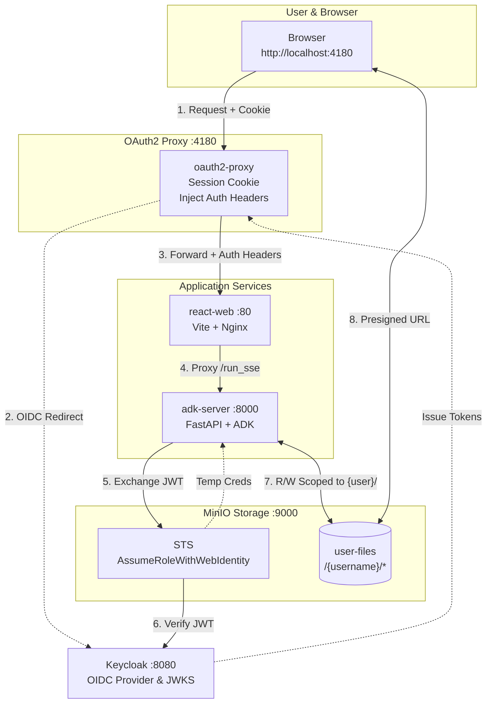
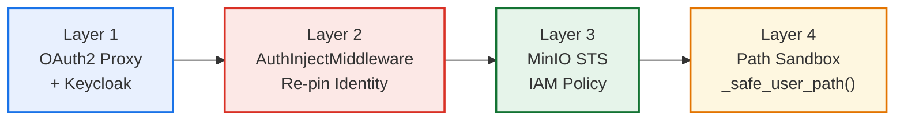
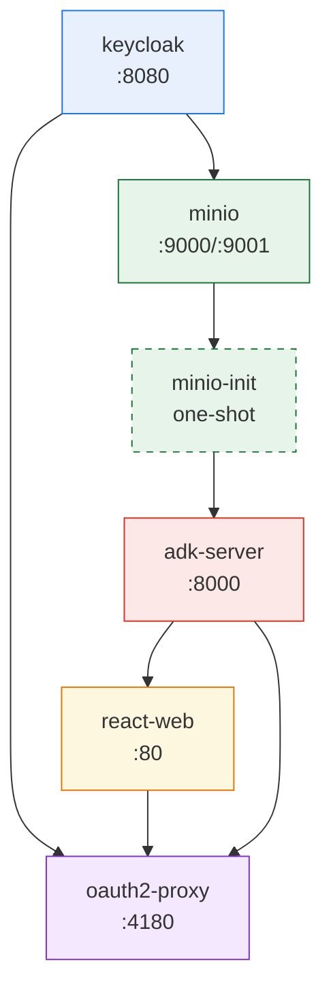
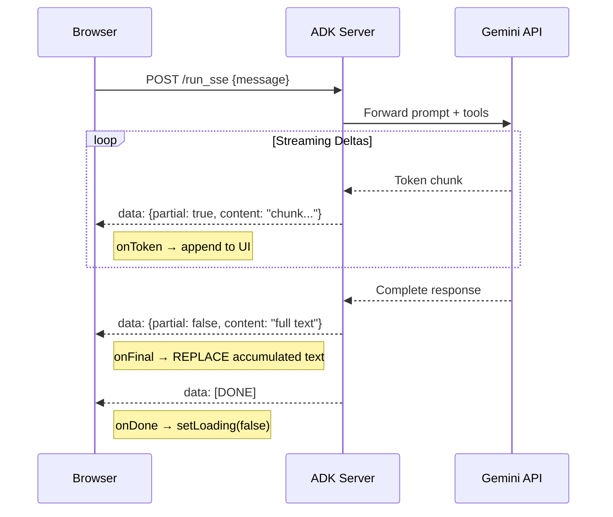
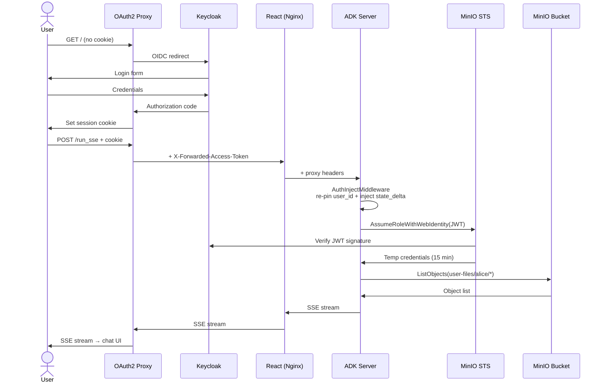
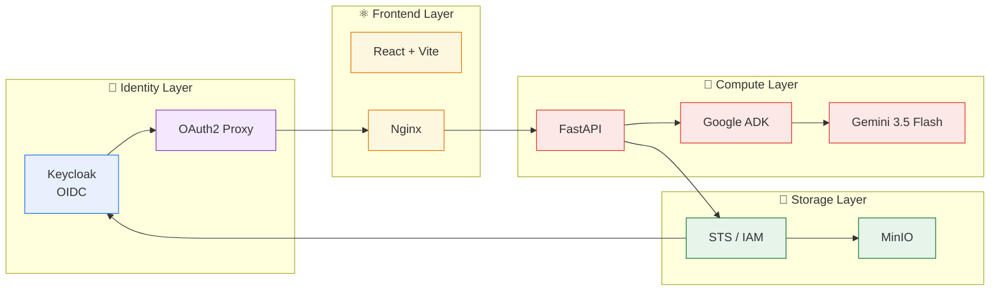

<!-- _class: lead -->
<!-- _backgroundColor: #1a73e8 -->
<!-- _color: white -->

# 📂 ADK File Assistant

### OAuth2 Proxy · Keycloak · MinIO STS

A personal file-management chatbot with **Gemini AI**, end-to-end per-user storage isolation, and zero client-side secrets.

<br>

**Google ADK · FastAPI · React · Docker Compose**

---

## 📋 Agenda

1. **What & Why** – Problem statement and project goals
2. **Architecture Overview** – Full request flow
3. **Authentication & Authorization** – Four-layer security model
4. **Service Stack** – All 6 Docker services explained
5. **ADK Server Deep Dive** – Middleware, agent, and tools
6. **React Frontend** – Chat UI with SSE streaming
7. **MinIO STS & IAM** – Per-user bucket scoping
8. **Deployment** – Docker Compose & configuration
9. **Demo Flow** – End-to-end verified scenarios
10. **Key Takeaways**

---

## 🎯 What & Why

### Problem

> How do you give each user their **own private file folder** on shared object storage, managed by an **AI assistant**, with **no client-side secrets**?

---

## 🎯 What & Why

### Solution

| Concern | Technology |
|---|---|
| **Identity** | Keycloak (OIDC) |
| **Session & proxy** | OAuth2 Proxy |
| **AI agent** | Google ADK + Gemini |
| **Storage** | MinIO with STS credentials |
| **Frontend** | React + Vite (no auth code) |

---

## 🏗️ Architecture Overview



---

## 🔐 Four-Layer Security Model


---

## 🔐 Four-Layer Security Model

| Layer | What it does |
|---|---|
| **OAuth2 Proxy + Keycloak** | Browser login, session cookies, forward `X-Forwarded-Access-Token` |
| **AuthInjectMiddleware** | Validates proxy headers, re-pins `user_id`, injects `state_delta` |
| **MinIO STS + IAM Policy** | JWT → 15-min temp credentials scoped to `${jwt:preferred_username}/*` |
| **`_safe_user_path()`** | Rejects `../` traversal, normalizes paths under `{username}/` |

---

## 🐳 Docker Compose Services


---

## 🐳 Docker Compose Services

| Service | Image | Port | Purpose |
|---|---|---|---|
| `keycloak` | `keycloak:26.0` | 8080 | OIDC identity provider |
| `minio` | `minio/minio` | 9000/9001 | Object storage + console |
| `minio-init` | `minio/mc` | — | Create bucket & IAM policy |
| `adk-server` | Custom Python | 8000 | Gemini agent + API |
| `react-web` | Custom Node+Nginx | 80 | Chat frontend |
| `oauth2-proxy` | `oauth2-proxy:v7.7.1` | 4180 | Auth gateway |

---

## ⚙️ Docker Compose – Key Config

```yaml
# docker-compose.yaml (excerpts)
services:
  minio:
    environment:
      MINIO_IDENTITY_OPENID_CONFIG_URL:
        "http://keycloak:8080/realms/my-realm/
         .well-known/openid-configuration"
      MINIO_IDENTITY_OPENID_CLIENT_ID: "adk-minio-client"
      MINIO_IDENTITY_OPENID_ROLE_POLICY: "user-folder-policy"
```

---

## ⚙️ Docker Compose – Key Config

```yaml
  adk-server:
    environment:
      MINIO_ENDPOINT: "minio:9000"
      MINIO_PUBLIC_ENDPOINT: "localhost:9000"
      MINIO_ROLE_ARN: "arn:minio:iam:::role/ivd6H_..."
      KEYCLOAK_JWKS_URL:
        "http://keycloak:8080/realms/my-realm/
         protocol/openid-connect/certs"
```

> **Key insight:** MinIO's role partition is `minio` (not `aws`) — the ARN must match what MinIO generates from `MINIO_IDENTITY_OPENID_ROLE_POLICY`.

---

## 🛡️ OAuth2 Proxy Configuration

```ini
# oauth2-proxy.cfg
provider = "keycloak-oidc"
oidc_issuer_url = "http://keycloak:8080/realms/my-realm"
client_id = "adk-minio-client"

# Session cookie config
cookie_secure = false
cookie_httponly = true
cookie_samesite = "lax"
cookie_refresh = "2m"

# Forward identity downstream
pass_access_token = true      # X-Forwarded-Access-Token
pass_user_headers = true      # X-Forwarded-User
set_xauthrequest = true       # X-Auth-Request-* headers

# Default upstream → React app
upstreams = ["http://react-web:80/"]
```

> **Zero client-side auth code** — React never sees or handles tokens.

---

## 🧠 ADK Server – AuthInjectMiddleware

Raw ASGI middleware (not `BaseHTTPMiddleware`) to avoid SSE corruption:

```python
class AuthInjectMiddleware:
    SKIP_PATHS = frozenset({"/docs", "/openapi.json"})
    REWRITTEN_PATHS = frozenset({"/run", "/run_sse"})

    async def __call__(self, scope, receive, send):
        # 1. Extract token from OAuth2 Proxy header
        token = headers.get("x-forwarded-access-token")

        # 2. Re-pin user identity on URL path
        #    /apps/{app}/users/{user}/... → force {user} = authenticated
        path = f"{prefix}{username}{suffix}"

        # 3. Rewrite POST body for /run and /run_sse
        payload["user_id"] = username
        payload["state_delta"] = {
            "keycloak_token": token,
            "username": username,
        }
```

> ⚠️ **Why raw ASGI?** `BaseHTTPMiddleware` caches `request.body()`, sending the original bytes downstream and corrupting the SSE disconnect handshake.

---

## 🤖 ADK Agent – Tool Definitions

```python
# my_agent/agent.py
from google.adk.agents import Agent

root_agent = Agent(
    name="minio_assistant",
    model="gemini-3.5-flash",
    description="Personal file management assistant on MinIO",
    instruction=(
        "You are a personal file management assistant. "
        "Use tools to list, read, upload, delete files, "
        "or generate download/upload links. "
        "Never access files outside the user's folder."
    ),
    tools=[
        list_my_files,
        upload_text_file,
        read_text_file,
        delete_file,
        get_download_link,
        get_upload_link,
    ],
)
```

---

## 🔧 Agent Tools – STS Credential Flow

```python
def _get_user_minio_client(tool_context: ToolContext):
    # 1. Retrieve JWT + username from ADK state_delta
    jwt_token = tool_context.state.get("keycloak_token")
    username  = tool_context.state.get("username")

    # 2. Exchange JWT for STS temp credentials (15 min)
    sts = boto3.client("sts", endpoint_url=f"http://{MINIO_ENDPOINT}")
    response = sts.assume_role_with_web_identity(
        RoleArn=MINIO_ROLE_ARN,
        RoleSessionName=f"adk-{username}"[:64],
        WebIdentityToken=jwt_token,
        DurationSeconds=900,  # 15 minutes
    )
    creds = response["Credentials"]

    # 3. Create scoped MinIO client
    client = Minio(MINIO_ENDPOINT,
        access_key=creds["AccessKeyId"],
        secret_key=creds["SecretAccessKey"],
        session_token=creds["SessionToken"])

    return client, public_client, username
```

---

## 🛡️ Agent Tools – Path Traversal Protection

```python
def _safe_user_path(username: str, filename: str) -> str:
    """Force path under {username}/ — reject traversal."""
    safe_user = posixpath.basename(username.strip())
    if not safe_user or safe_user in (".", ".."):
        raise ValueError("Invalid username")

    raw = filename.strip().lstrip("/")
    if raw.startswith(f"{safe_user}/"):
        raw = raw[len(safe_user) + 1:]

    normalized = posixpath.normpath(raw)
    if (not normalized
        or normalized in (".", "..")
        or normalized.startswith("../")
        or "/../" in f"/{normalized}/"):
        raise ValueError("Invalid file path")

    return f"{safe_user}/{normalized}"
```
---

## 🛡️ Agent Tools – Path Traversal Protection

| Input | Output | Status |
|---|---|---|
| `notes.txt` | `alice/notes.txt` | ✅ |
| `../bob/secret.txt` | — | ❌ Rejected |
| `/etc/passwd` | — | ❌ Rejected |

---

## 📦 Agent Tool Functions

| Tool | Signature | Action |
|---|---|---|
| `list_my_files` | `(tool_context)` | List objects under `{user}/` prefix |
| `upload_text_file` | `(filename, content, tool_context)` | PUT UTF-8 text file |
| `read_text_file` | `(filename, tool_context)` | GET + decode text file |
| `delete_file` | `(filename, tool_context)` | Stat → Remove object |
| `get_download_link` | `(filename, tool_context)` | 10-min presigned GET URL |
| `get_upload_link` | `(filename, tool_context)` | 10-min presigned PUT URL |

---

## 📦 Agent Tool Functions

```python
def upload_text_file(filename: str, content: str,
                     tool_context: ToolContext) -> str:
    client, _, username = _get_user_minio_client(tool_context)
    object_name = _safe_user_path(username, filename)
    data = content.encode("utf-8")
    client.put_object(MINIO_BUCKET, object_name,
                      io.BytesIO(data), len(data),
                      content_type="text/plain; charset=utf-8")
    return f"File '{filename}' saved successfully."
```

---

## 🔒 MinIO IAM Policy – Per-User Scoping

```json
{
  "Version": "2012-10-17",
  "Statement": [
    {
      "Effect": "Allow",
      "Action": ["s3:GetBucketLocation"],
      "Resource": "arn:aws:s3:::user-files"
    },
    {
      "Effect": "Allow",
      "Action": ["s3:ListBucket"],
      "Resource": "arn:aws:s3:::user-files",
      "Condition": {
        "StringLike": {
          "s3:prefix": ["${jwt:preferred_username}/*"]
        }
      }
    },
    {
      "Effect": "Allow",
      "Action": ["s3:GetObject","s3:PutObject","s3:DeleteObject"],
      "Resource":
        "arn:aws:s3:::user-files/${jwt:preferred_username}/*"
    }
  ]
}
```

> `${jwt:preferred_username}` is resolved by MinIO from the Keycloak JWT claim at STS time.

---

## 🌐 Nginx Reverse Proxy

```nginx
# react-web/nginx.conf
server {
    listen 80;

    # Proxy ADK endpoints to adk-server
    location ~ ^/(apps|run|run_sse)(/|$) {
        resolver 127.0.0.11 valid=10s ipv6=off;
        set $adk_upstream http://adk-server:8000;
        proxy_pass $adk_upstream;

        # Forward OAuth2 Proxy identity headers
        proxy_set_header X-Forwarded-Access-Token
            $http_x_forwarded_access_token;
        proxy_set_header X-Forwarded-Preferred-Username
            $http_x_forwarded_preferred_username;

        # Critical for SSE streaming
        proxy_buffering off;
        proxy_cache off;
        proxy_read_timeout 300s;
    }

    # SPA fallback
    location / {
        try_files $uri $uri/ /index.html;
    }
}
```

---

## ⚛️ React Frontend – Chat UI

```tsx
// src/App.tsx
export function App() {
  const sessionId = useMemo(() => getOrCreateSessionId(), []);

  const handleSignOut = () => {
    sessionStorage.removeItem("adk_session_id");
    // Chain: OAuth2 Proxy sign_out → Keycloak logout → redirect
    const keycloakLogout = encodeURIComponent(
      "http://localhost:8080/realms/my-realm/" +
      "protocol/openid-connect/logout" +
      "?client_id=adk-minio-client" +
      "&post_logout_redirect_uri=" +
        encodeURIComponent("http://localhost:4180/")
    );
    window.location.href =
      `/oauth2/sign_out?rd=${keycloakLogout}`;
  };

  return (
    <div className="app-viewport">
      <header>...</header>
      <ChatBox username="proxy-user" sessionId={sessionId} />
      <footer>Powered by Gemini · Keycloak · MinIO STS</footer>
    </div>
  );
}
```

> `username="proxy-user"` is a placeholder — the server **re-pins** it to the real Keycloak identity.

---

## 📡 SSE Streaming – Client Implementation

```typescript
// src/adkStream.ts
export async function streamMessageToAgent(params) {
  // 1. Ensure ADK session exists (POST, 409 = ok)
  await ensureAdkSession(baseUrl, appName, username, sessionId);

  // 2. Stream via Server-Sent Events
  const response = await fetch(`${baseUrl}/run_sse`, {
    method: "POST",
    credentials: "include",
    headers: { Accept: "text/event-stream" },
    body: JSON.stringify({
      app_name: appName,
      user_id: username,
      session_id: sessionId,
      streaming: true,
      new_message: { role: "user", parts: [{ text: message }] },
    }),
  });

  // 3. Parse SSE frames
  const reader = response.body.getReader();
  // partial === true  → streaming delta (append)
  // partial === false → complete text (REPLACE, not append)
}
```

---

## 📡 SSE Delta vs Final Event Handling



> **Key pattern:** The final event contains the full text. `onFinal` **replaces** (not appends) to avoid duplication.

---

## 💬 ChatBox Component – Streaming UX

```tsx
// src/chatBox.tsx
await streamMessageToAgent({
  username, sessionId, message: prompt,
  callbacks: {
    onToken: (chunk) => {
      // Append delta to assistant message
      setMessages(prev => prev.map(msg =>
        msg.id === assistantMsgId
          ? { ...msg, text: msg.text + chunk }
          : msg
      ));
    },
    onFinal: (fullText) => {
      // Replace with final complete text
      setMessages(prev => prev.map(msg =>
        msg.id === assistantMsgId
          ? { ...msg, text: fullText }
          : msg
      ));
    },
    onError: (e) => {
      // Auto-detect token expiry → suggest refresh
      const isExpired = e.message.includes("401");
      // Show appropriate error message
    },
  },
});
```

---

## 🔄 Complete Request Flow



---

## 📂 Project Structure

```text
adk-minio-keycloak/
├── .env                        # GOOGLE_GENAI_API_KEY
├── docker-compose.yaml         # 6 services orchestration
├── oauth2-proxy.cfg            # OIDC client + cookie config
├── user-folder-policy.json     # MinIO IAM (JWT-scoped)
│
├── keycloak/
│   └── my-realm.json           # Realm auto-imported on boot
│
├── adk-server/
│   ├── Dockerfile              # Python 3.12 slim
│   ├── requirements.txt        # google-adk, minio, boto3, pyjwt
│   ├── main.py                 # AuthInjectMiddleware + CORS
│   └── my_agent/
│       ├── __init__.py
│       └── agent.py            # Gemini agent + 6 MinIO tools
│
└── react-web/
    ├── Dockerfile              # Multi-stage: Node build → Nginx
    ├── nginx.conf              # Reverse proxy + SSE config
    └── src/
        ├── App.tsx             # Layout + sign-out
        ├── chatBox.tsx         # Chat UI + suggestion chips
        └── adkStream.ts        # SSE streaming client
```

---

## 🚀 Quick Start (1/3)

```bash
# 1. Clone and configure
git clone <repo-url> && cd adk-minio-keycloak
echo "GOOGLE_GENAI_API_KEY=your-key-here" > .env

# 2. Launch all services
docker compose up -d --build

# 3. Wait for Keycloak health check (~30s)
docker compose logs -f keycloak | grep "started"

```

---

## 🚀 Quick Start (2/3)

```bash
# 4. Create a test user in Keycloak
#    → http://localhost:8080/admin (admin / admin_password)
#    → Realm: my-realm → Users → Add user

# 5. Open the app
#    → http://localhost:4180
#    → Login with Keycloak credentials
#    → Chat with the AI file assistant!
```

---

## 🚀 Quick Start (3/3)

| URL | Service |
|---|---|
| `http://localhost:4180` | App (via OAuth2 Proxy) |
| `http://localhost:8080` | Keycloak Admin Console |
| `http://localhost:9001` | MinIO Console |

---

## ✅ Verified End-to-End Test Matrix

| Test Case | Expected |
|---|---|
| Sign-in via Keycloak → Proxy → React | Session cookie set |
| Create `hello.txt` via agent | File at `user-files/alice/hello.txt` |
| List files | Shows `hello.txt (38 bytes)` |
| Read file content | Returns exact content |
| Cross-user isolation (`other/`) | `AccessDenied` |
| Missing token | HTTP 401 |
| Foreign origin | HTTP 403 |
| CORS preflight | HTTP 200 |
| SSE streaming | Deltas + final replacement |
| Presigned download URL | Direct browser download |

---

## 🧩 Technology Stack Summary



---

## 💡 Key Design Decisions

### Why Raw ASGI Middleware?
`BaseHTTPMiddleware` caches `request.body()` and replays the **original** bytes, breaking `/run_sse` disconnect handling.

### Why Two MinIO Clients?
- **Internal client** (`minio:9000`) — used by agent tools inside Docker
- **Public client** (`localhost:9000`) — generates presigned URLs the **browser** can reach

### Why `proxy-user` Placeholder?
React sends `username="proxy-user"` for all users. The `AuthInjectMiddleware` **re-pins** it to the real Keycloak identity — the client **cannot** impersonate another user.

### Why `cookie_refresh = "2m"`?
OAuth2 Proxy silently refreshes the access token every 2 minutes using the refresh token, keeping the session alive without redirects.

---

## ⚠️ Common Pitfalls & Solutions

| Pitfall | Solution |
|---|---|
| `AccessDenied` on `ListBucket` | Add `s3:GetBucketLocation` to the bucket-level statement |
| STS rejects `AssumeRole` | ARN must use `arn:minio:...` (not `arn:aws:...`) |
| Presigned URL fails in browser | Use `MINIO_PUBLIC_ENDPOINT` for browser-reachable URLs |
| SSE duplicates final message | `onFinal` must **replace**, not append |
| `RuntimeError: Unexpected message http.request` | Use raw ASGI, not `BaseHTTPMiddleware` |
| ADK ignores `GOOGLE_GENAI_API_KEY` | Bridge to `GOOGLE_API_KEY` — the SDK reads that one |

---

<!-- _class: lead -->
<!-- _backgroundColor: #1a73e8 -->
<!-- _color: white -->

# 🎉 Thank You!

### ADK File Assistant

**Zero client-side secrets · Per-user storage isolation · AI-powered file management**

<br>

🔗 Built with Google ADK · Gemini · Keycloak · MinIO · OAuth2 Proxy · React

<br>

📂 `docker compose up -d --build` → `http://localhost:4180`
